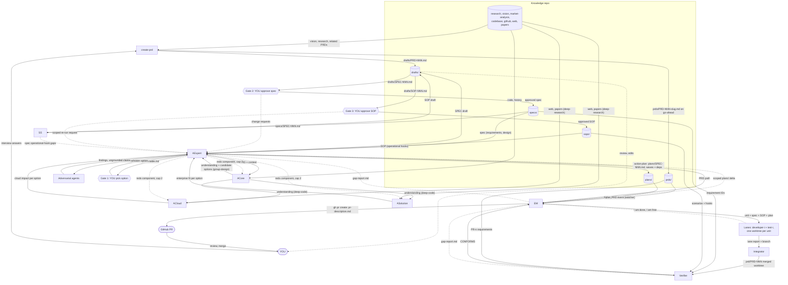
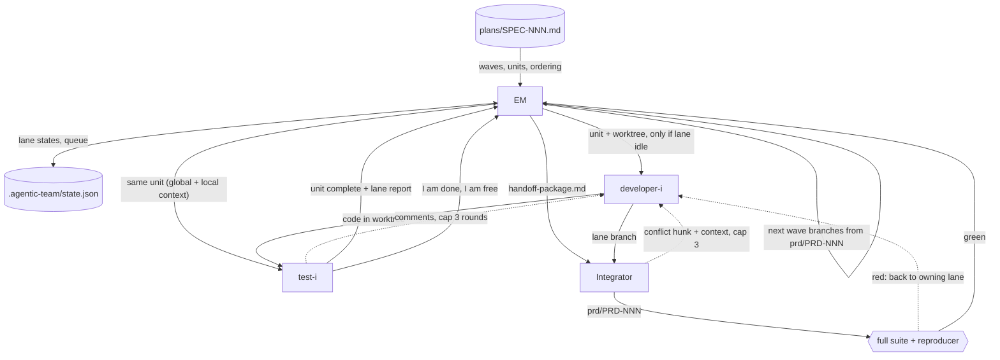

# agentic-product-function

A skill that models a product function as a team of agents. You write a PRD. An architect team assesses it, you approve an option, a spec and an SOP at three gates, and a fixed pool of developer+tester lanes builds it in git worktrees, verifies it against the PRD, spec and SOP, and opens a GitHub PR with `gh`.

See `agentic-team.png` for the original diagram (out of date: lanes are dev+test pairs, and the integrator and verifier are missing).

**Status:** built, not yet run end to end. The tutorial below describes the intended behaviour, not recorded output. See [Known gaps](#known-gaps).

## Contents

1. [Tutorial](#tutorial)
2. [Players](#players)
3. [Artifacts: who writes and reads what](#artifacts-who-writes-and-reads-what)
4. [Flows](#flows)
5. [Data-flow DAGs](#data-flow-dags)
6. [Rules and caps](#rules-and-caps)
7. [Document standards](#document-standards)
8. [Skills and packaging](#skills-and-packaging)
9. [Known gaps](#known-gaps)

---

## Tutorial

Worked example: you want rate limiting on a service's public API.

### 0. Prerequisites
- A git repository containing the codebase the feature changes (ACore reads it). Run Claude Code from its root.
- `gh` installed and authenticated (`gh auth status`). GitHub is always the host.
- Anthropic's `anthropic-skills` plugin installed (provides `deep-research`).
- `python3` (for the PRD watcher).

### 1. Start the team (do this first)
```
/agentic-product-function lanes=3
```
This session becomes the **EM**. It creates `prds/ specs/ sops/ plans/ drafts/ .agentic-team/` if missing, writes `.agentic-team/state.json` with 3 idle lanes, and arms the PRD watcher. 3 lanes means 3 developers, each paired with a tester. Capacity is fixed for the session.

Start the EM *before* writing the PRD. The watcher treats any PRD that already exists when it first starts as already seen.

### 2. Write the PRD
```
/create-prd
```
The skill orients itself (next ID, vision and research files if present), then interviews you in small batches: problem, goals and non-goals, users, requirements, success metrics, constraints and risks. It pushes back on vague requirements ("fast", "scalable") and asks for a measurable criterion. It keeps requirements to *what*, not *how*. Requirement IDs are `PR-1`, `PR-2`, ...

It writes `drafts/PRD-001.md` and edits it with you. When you say it is ready, it writes `prds/PRD-001-api-rate-limiting.md` in one write. **That write starts the flow.**

### 3. Architecture runs
The EM flags the new PRD in one line and hands over to **AExpert** (you now talk to AExpert about architecture). Behind the scenes:
1. ACore reads your codebase (`deep-code`), then proposes competing designs (`group-design`).
2. ACloud and ASolution run in parallel on ACore's output (`deep-research`): cloud side effects, and fit in enterprise deployments.
3. AExpert launches adversarial agents, chosen for this PRD (for example: "what breaks during a rolling upgrade?", "is every claim cited?"). It can send components back to the architects, at most 2 rounds.

You can step away. It takes a while.

### 4. Gate 1: pick an option
AExpert shows a short table: one row per option, scored on **risk, complexity, future evolution, fit for purpose**, with links to the detail, plus its recommendation. You can:
- Pick an option: "Option B".
- Ask for a scoped re-run: "redo ACloud, assuming multi-region".

### 5. Gate 2: approve the spec
AExpert writes `drafts/SPEC-001.md` in the fixed spec template and shows it to you. Ask for changes in plain language; it edits the draft in place. Every requirement has an ID (`R-1`...) linked to your `PR-n`. When you approve, it moves to `specs/SPEC-001.md`.

### 6. Gate 3: approve the SOP
SS builds `drafts/SOP-001.md` from the approved spec: one runbook scenario per risk ("if you see X, do Y, roll back with Z"). If a risk has no usable monitoring signal, the SOP records a gap and AExpert fixes the spec first (you re-approve that part).

If you want something in the SOP addressed, say so. AExpert re-runs the architecture flow, scoped to exactly what you asked, and a spec change needs your re-approval of the delta.

When both the spec and SOP are approved, the SOP moves to `sops/SOP-001.md`.

### 7. The plan (no review needed)
AExpert runs `action-plan` on the approved spec and SOP: test-first steps grouped into waves, parallel by default. It writes `plans/SPEC-001.md` and hands it to the EM. You do not review this.

### 8. Engineering runs
The EM dispatches the plan's units to **idle lanes only**. If all 3 lanes are busy, units queue. For each unit:
- A worktree is created; the developer works in it and sends the result to its paired tester.
- They loop on comments (max 3 rounds). The tester declares the unit complete and reports "I am done, I am free". The EM sends that lane the next queued unit.
- A wave must be merged before the next wave starts. If a plan is split across lanes, the **integrator** merges the lane worktrees into `prd/PRD-001` and runs the full suite and the reproducer. A plan taken by one lane needs no merge.

Check progress any time:
```
cat .agentic-team/state.json     # lanes, units, PRD phase, wave, PR URL
```

### 9. Verification and the PR
The **Verifier** checks the output against every requirement ID and SOP scenario, citing code and test results.
- **CONFORMS:** the EM pushes `prd/PRD-001` and runs `gh pr create` with a full description (summary, requirement table, SOP link, test results, risks). The URL is in `state.json`. **Review and merge the PR yourself.**
- **Gaps:** the Requirement Gap flow runs (next section). At most 2 gap cycles, then it escalates to you.

### 10. Next PRD
Just run `/create-prd` again. PRDs run through architecture one at a time (the main session is busy with you), while lanes keep building earlier plans in the background.

### Troubleshooting
| Symptom | Cause / fix |
|---|---|
| Wrote a PRD, nothing happened | EM was not running. Start it, then move the PRD out of `prds/` and back in. |
| Edited a PRD and nothing happened | Edits to a seen PRD are ignored. Drop the revision in as a new file (new ID). |
| Units not starting | All lanes busy; units queue until a lane reports free. Check `state.json`. |
| Architecture stalls on `deep-research` | Make sure `anthropic-skills` is installed. |
| PR step fails | `gh auth status`; confirm the repo has a GitHub remote. |

---

## Players

| Agent | Role |
|---|---|
| **YOU** | Human in the loop. Write PRDs (with `create-prd`), make every approval decision at gates 1-3. |
| **EM** (engineering-manager) | The main session. Watches `prds/` (kqueue on macOS, poll fallback elsewhere, via Monitor), starts the flow, hands control to AExpert, dispatches plans to lanes by capacity, tracks free lanes, pushes PRs with `gh`. |
| **AExpert** (architect-chief) | Manager of the architecture team and the final word. The only agent that talks to you about architecture. Runs adversarial review, writes the spec, runs `action-plan`. A role the main session plays after the EM hands over. |
| **ACore** (architect-core) | `deep-code` to understand the codebase against the PRD, then `group-design` to formulate candidate designs. |
| **ACloud** (architect-cloud) | ACore's output + `deep-research`: side effects on cloud deployment. |
| **ASolution** (architect-solution) | ACore's output + `deep-research`: the PRD in enterprise deployments with existing services. |
| **SS** (support-sop) | Builds the SOP from the approved spec. |
| **Lane** (developer-i + test-i) | A developer paired with a tester. N lanes, set at invocation. Each unit of work is isolated in a git worktree. |
| **Integrator** | Merges lane worktrees into one output worktree when a plan is split across lanes. |
| **Verifier** | Checks finished work against the PRD, spec requirement IDs and SOP. Produces a gap report. |

---

## Artifacts: who writes and reads what

| Artifact | Path (in your project) | Written by | Read by | Template |
|---|---|---|---|---|
| PRD draft | `drafts/PRD-NNN.md` | `create-prd` | YOU | `templates/prd.md` |
| PRD | `prds/PRD-NNN-<slug>.md` | `create-prd` (on your go-ahead) | watcher → EM, AExpert, ACore, ACloud, ASolution, Verifier | `templates/prd.md` |
| Knowledge repo context | `research/ product-vision company-vision market-analysis` + codebase, github, web, papers | YOU / existing | create-prd, AExpert, architects | none |
| Candidate options | AExpert's working output | ACore | ACloud, ASolution, AExpert | none |
| Cloud impact / enterprise fit | AExpert's working output | ACloud / ASolution | AExpert | none |
| Option table (gate 1) | shown to you | AExpert | YOU | `templates/option-table.md` |
| Spec draft | `drafts/SPEC-NNN.md` | AExpert | YOU, SS | `templates/spec.md` |
| Spec (approved) | `specs/SPEC-NNN.md` | AExpert (on approval) | SS, `action-plan`, lanes, integrator, Verifier | `templates/spec.md` |
| SOP draft | `drafts/SOP-NNN.md` | SS | YOU, AExpert | `templates/sop.md` |
| SOP (approved) | `sops/SOP-NNN.md` | AExpert (on approval) | `action-plan`, lanes, integrator, Verifier | `templates/sop.md` |
| Plan | `plans/SPEC-NNN.md` (+ `.candidate-*.md`) | AExpert via `action-plan` | EM, lanes, integrator | `skills/action-plan` |
| Orchestration state | `.agentic-team/state.json`, `.agentic-team/seen.txt` | EM only | EM | `roles/engineering-manager.md` |
| Unit worktree + lane report | `../<repo>.worktrees/…` | developer / tester | integrator, Verifier | none |
| Handoff package | in the integrator's prompt | EM | integrator | `templates/handoff-package.md` |
| Integration branch | `prd/PRD-NNN` | integrator | Verifier, EM | git |
| Gap report | EM's message to AExpert | Verifier | EM, AExpert | `templates/gap-report.md` |
| Pull request | GitHub | EM (`gh pr create`) | YOU | `templates/pr-description.md` |

`specs/` and `sops/` hold approved artifacts only. Drafts live in `drafts/`.

---

## Flows

### Architecture (owner: AExpert)

| Step | Actor | Input | Output |
|---|---|---|---|
| 1 | EM | `prds/PRD-NNN.md` (NEW_PRD event) | handover to AExpert |
| 2 | ACore | PRD, repo | understanding + candidate options |
| 3 | ACloud, ASolution (parallel) | ACore output | cloud impact, enterprise fit |
| 4 | AExpert + adversarial agents | all outputs | findings; redo requests (cap 2 rounds) |
| 5 | **Gate 1** (you) | option table | chosen option |
| 6 | AExpert | chosen option | `drafts/SPEC-NNN.md` |
| 7 | **Gate 2** (you) | draft spec | approval, or changes (loop to 6) → `specs/` |
| 8 | SS | approved spec | `drafts/SOP-NNN.md` (+ gaps) |
| 9 | **Gate 3** (you) | draft SOP | approval → `sops/`, or a scoped re-run of the architecture flow (fresh 2-round cap) |
| 10 | AExpert | spec AND SOP approved | `plans/SPEC-NNN.md` → EM |

A spec change caused by SOP feedback needs re-approval of the delta only. The gate to the EM is spec approved AND SOP approved.

### Engineering (owner: EM)

1. The EM dispatches the plan's units to **idle** lanes only, wave by wave. No idle lane means units queue, even when a plan is ready.
2. Each unit gets a worktree. The lane's developer and tester receive the spec, the SOP, the whole plan (global context) and their unit (local context).
3. developer → tester → comments → developer, **cap 3 rounds**, then escalate to the EM, then you. The tester declares the unit complete and tells the EM "I am done, I am now free".
4. A crashed or stalled lane: the EM reassigns its unit to another idle lane.
5. Plan split across lanes: after each wave the **integrator** merges into `prd/PRD-NNN` (next wave branches from it). Plan taken by a single lane: no merge.
6. The **Verifier** checks the output. `CONFORMS` → the EM pushes and opens the PR. Gaps → Requirement Gap.

**Integrator handoff package:** spec, SOP, whole plan, ordering constraints, base commit SHA, each unit's file ownership and requirement IDs, each lane's diff and report (what changed, why, interfaces touched, tests added). After a merge it runs the full suite and the plan's reproducer. An unresolvable conflict goes back to the owning lane with the hunk, both sides and the context (cap 3), then to the EM, then to you.

**Pull request:** always GitHub, always `gh`, always described: summary, PRD and spec IDs, requirement table (where implemented and tested), SOP link and Verifier result, test results, risks and gap cycles, and the Claude Code attribution line.

### Requirement Gap (lighter variant of the architecture flow)
1. The Verifier writes a gap report: each unmet or partial requirement ID or SOP item, with evidence.
2. The EM hands it to AExpert and counts the cycle.
3. AExpert runs a scoped flow: ACore (`deep-code` on the gap only); ACloud/ASolution only if the gap touches their area; adversarial review narrowed to the gap; gate 1 skipped (the chosen option stands). A needed spec or SOP change goes to you for re-approval (gates 2/3); otherwise no human gate.
4. AExpert runs a scoped `action-plan` for only the units that close the gap.
5. The EM dispatches to idle lanes, merges, and the Verifier checks again.
6. Cap: 2 gap cycles, then escalate to you.

---

## Data-flow DAGs

Each edge is labelled with the artifact it carries. Solid edges form the DAG for one PRD; dashed edges are feedback loops (each capped, see [Rules and caps](#rules-and-caps)).

### End to end



### Engineering detail (one wave)



---

## Rules and caps

| Rule | Value |
|---|---|
| Who talks to you about architecture | AExpert only |
| Grounding | Every claim cites a `file:line` or URL; AExpert enforces |
| Architecture redo loop | 2 rounds, then escalate to you |
| Scoped re-run after you change the SOP | fresh 2-round cap |
| Dev ↔ test loop | 3 rounds, then EM, then you |
| Integrator conflict loop | 3 rounds, then EM, then you |
| Requirement Gap cycles | 2, then escalate to you |
| Adversarial angles | chosen per PRD |
| Gate to the EM | spec approved AND SOP approved |
| Plan review | none, it goes straight to the EM |
| Capacity | lanes only; no idle lane means no dispatch |
| Parallelism | by default, if the plan permits |
| Done means | the work addresses the PRD, the spec and the SOP |
| Output | one branch and one GitHub PR per PRD |

---

## Document standards

Decided once and used always.

| Document | Standard | Template |
|---|---|---|
| PRD | No single standard; the sections common across Atlassian, Product School and others (problem, goals/non-goals, users, requirements with acceptance criteria, metrics, constraints, open questions). PRD requirements get IDs (`PR-n`). | `templates/prd.md` |
| Spec | IEEE 29148-style verifiable, ID'd requirements ("what", `R-n`) kept separate from the design ("how", RFC/design-doc style), with a MADR 4.0 decision record. | `templates/spec.md` |
| SOP | Incident-runbook structure: severity, detection, immediate response, investigation, mitigation, rollback, communication, escalation, post-incident. | `templates/sop.md` |

Caveats: IEEE 29148 is paywalled, so its structure comes from secondary sources. The SOP structure comes from third-party runbook templates, not the Google SRE book or PagerDuty docs directly (those did not come up in search).

---

## Skills and packaging

- **Vendored (copied into this repo, adapted where noted):** `deep-code`, `group-design`, `action-plan` (AExpert builds the skeleton from the approved spec and SOP, not the chat; writes to `plans/`; the "parallel agents?" question is skipped).
- **Ours:** `create-prd`.
- **Referenced, not copied:** `deep-research` from Anthropic's `anthropic-skills`. Installers need that plugin.

One distributable skill (skills.sh):

```
SKILL.md              entry point: /agentic-product-function lanes=N
roles/                engineering-manager, architect-chief, architect-core, architect-cloud,
                      architect-solution, support-sop, developer, tester, integrator, verifier
flows/                architecture.md, engineering.md, requirement-gap.md
templates/            prd, spec, sop, option-table, gap-report, handoff-package, pr-description
skills/               deep-code, group-design, action-plan (vendored); create-prd (ours)
scripts/watch-prds.py kqueue watcher (poll fallback elsewhere)
```

The knowledge-repo directories (`prds/ specs/ sops/ plans/ drafts/`) and `.agentic-team/` live in your project and are created on first run.

---

## Known gaps

- Not run end to end. Tested so far: the watcher reports a new PRD and ignores existing ones.
- Whether subagents can message each other (developer ↔ tester, integrator → lane) as `flows/engineering.md` assumes.
- The watcher's non-macOS path is a 2-second poll, not inotify.
- `deep-research` must be installed separately.
- `agentic-team.png` is out of date.
