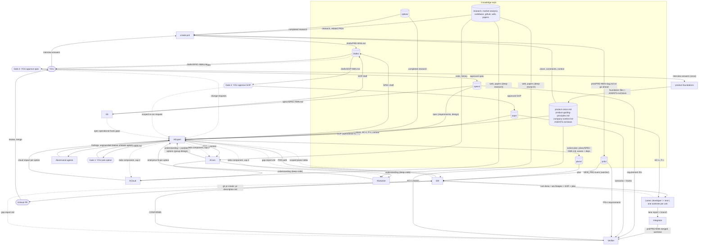
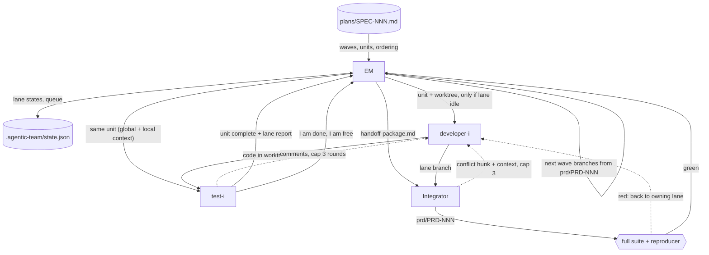
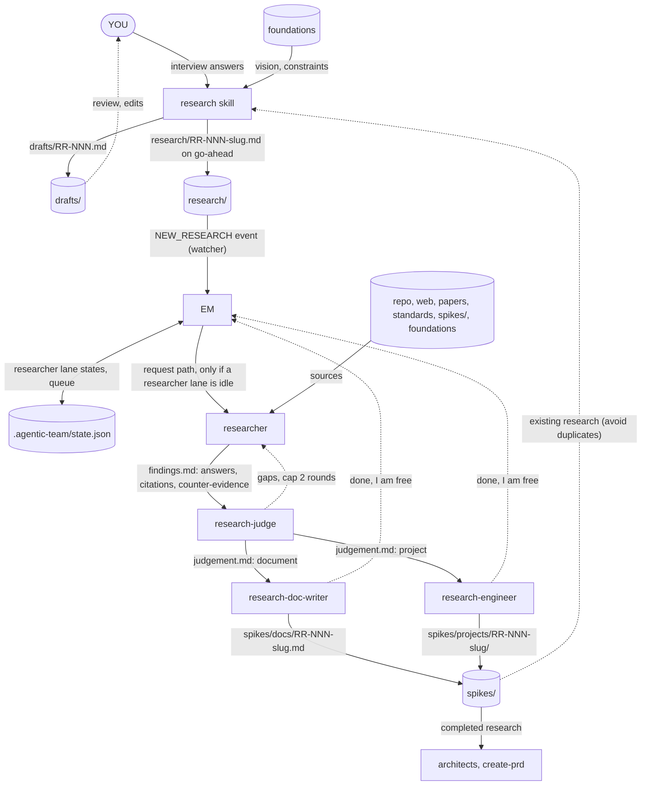

<p align="center"></p>

# agentic-product-function

A skill that models a product function as a team of agents. You write a PRD. An architect team assesses it, you approve an option, a spec and an SOP at three gates, and a fixed pool of developer+tester lanes builds it in git worktrees, verifies it against the PRD, spec and SOP, and opens a GitHub PR with `gh`. A second team of researchers takes research requests from `research/` and closes each with a spike (a document or a small project) in `spikes/`.

See `agentic-team.png` for the original diagram (out of date: lanes are dev+test pairs, and the integrator and verifier are missing).

**Status:** built, not yet run end to end. The tutorial below describes the intended behaviour, not recorded output. See [Known gaps](#known-gaps).

## Contents

1. [Install](#install)
2. [Tutorial](#tutorial)
3. [Players](#players)
4. [Artifacts: who writes and reads what](#artifacts-who-writes-and-reads-what)
5. [Flows](#flows)
6. [Data-flow DAGs](#data-flow-dags)
7. [Rules and caps](#rules-and-caps)
8. [Document standards](#document-standards)
9. [Skills and packaging](#skills-and-packaging)
10. [Known gaps](#known-gaps)

---

## Install

Four skills ship in this repo: `product-foundations` (one-time setup of your vision, principles and company context), `agentic-product-function` (the team) `create-prd` (how you write PRDs) and `research` (how you request research). Install them with the [skills CLI](https://github.com/vercel-labs/skills) (skills.sh). The repo is public, so no authentication is needed.

**Prerequisites:** Node.js (for `npx`), a git repository with a GitHub remote, `gh` authenticated, `python3`, and Anthropic's `anthropic-skills` plugin (the CLI cannot install it; it provides `deep-research`).

### 1. Preview what the repo offers (optional)
```bash
npx skills add gbarnett-hz/agentic-product-function --list
```
You should see four skills: `product-foundations`, `agentic-product-function`, `create-prd` and `research`.

### 2. Install into your project
```bash
cd your-project
npx skills add gbarnett-hz/agentic-product-function \
  --skill product-foundations --skill agentic-product-function --skill create-prd --skill research -a claude-code
```
- Installs to `./.claude/skills/` (project scope). Commit that folder if you want your team to share it.
- Add `-g` to install to `~/.claude/skills/` instead, for every project on your machine.
- Add `--copy` for independent copies instead of the default symlinks to a canonical copy.
- Add `-y` to skip prompts. Do not use `--all`: it installs to every detected agent without prompting.
- Without flags the CLI is interactive: it lists the skills and detected agents and asks you to choose.
- The full URL also works: `npx skills add https://github.com/gbarnett-hz/agentic-product-function`.

### 3. Start a new Claude Code session
Skills load at session start. Then follow the [tutorial](#tutorial): `/product-foundations` once, then `/agentic-product-function lanes=3 researchers=2`, then `/create-prd` or `/research`.

### Update and remove
```bash
npx skills update                      # update installed skills (add -g for global only)
npx skills remove product-foundations agentic-product-function create-prd research
```

### Notes
- `deep-code`, `group-design` and `action-plan` are bundled inside `agentic-product-function/vendor/` and read by path. They are not installed as separate skills, so they do not collide with skills of the same name you already have.
- Local checkout instead of GitHub: `npx skills add /path/to/this/repo --skill product-foundations --skill agentic-product-function --skill create-prd --skill research -a claude-code`.
- Skills run with full agent permissions. Review them before use.
- Verified: `--list` and a non-interactive install from `gbarnett-hz/agentic-product-function` on GitHub put the two skills that existed at the time (`agentic-product-function`, `create-prd`) in `./.claude/skills/`; `product-foundations` was added afterwards and is not yet install-tested (as copies, because the run was non-interactive). The installed skills have not been run (see [Known gaps](#known-gaps)).

---

## Tutorial

Worked example: you want rate limiting on a service's public API.

### 0. Prerequisites
- A git repository containing the codebase the feature changes (ACore reads it). Run Claude Code from its root.
- `gh` installed and authenticated (`gh auth status`). GitHub is always the host.
- The skills installed (see [Install](#install)), including Anthropic's `anthropic-skills` plugin (provides `deep-research`).
- `python3` (for the PRD watcher).
- Your project's foundations written (step 1). `/agentic-product-function` stops if they are missing.

### 1. Set up the foundations (once per project)
```
/product-foundations
```
Before any PRD, the team needs to know what you are building and the rules you hold. The skill interviews you, one document at a time, and drafts each in `drafts/` for your approval:
- `product-vision.md`: the end goal, who it is for, what it will never be, how success is measured.
- `product-guiding-principles.md`: hard constraints (for example "Java 21", "zero runtime memory allocation") and judgement principles. Each one gets a rationale, its implications, a **verification** (a lint rule, benchmark or test, or `judgement`) and who may grant exceptions. Hard constraints get IDs (`HC-n`), principles `P-n`.
- `company-context.md`: the company's execution space and guiding philosophies (customers, strategy, constraints such as compliance, release cadence, approved technologies).

It offers suggestions from your repo (for example Java 21 from a build file) but never writes them as decided without your confirmation. Re-running refines existing files; it never silently overwrites them.

As each file is written it updates a managed block in `AGENTS.md` that references it, and makes sure `CLAUDE.md` imports `@AGENTS.md` (Claude Code reads `CLAUDE.md`, not `AGENTS.md`; it asks before editing an existing `CLAUDE.md`). Commit the files.

From here on the team uses them: architects rule out or flag options that violate a hard constraint, developers and testers adhere to them, and the Verifier checks them.

### 2. Start the team (do this first)
```
/agentic-product-function lanes=3 researchers=2
```
This session becomes the **EM**. It creates `prds/ specs/ sops/ plans/ drafts/ .agentic-team/` (and, when researchers ≥ 1, `research/ spikes/docs/ spikes/projects/`) if missing, writes `.agentic-team/state.json` with 3 idle engineering lanes and 2 idle researcher lanes, and arms the watchers for `prds/` and `research/`. 3 lanes means 3 developers, each paired with a tester. 2 researchers means 2 researcher lanes, each with its own researcher, judge, doc writer and research engineer. Capacity is fixed for the session; `researchers=0` turns research off.

Start the EM *before* writing the PRD. The watchers treat any PRD or research request that already exists when they first start as already seen.

### 3. Write the PRD
```
/create-prd
```
The skill orients itself (next ID, the three foundation files, research files if present), then interviews you in small batches: problem, goals and non-goals, users, requirements, success metrics, constraints and risks. It pushes back on vague requirements ("fast", "scalable") and asks for a measurable criterion. It keeps requirements to *what*, not *how*. Requirement IDs are `PR-1`, `PR-2`, ...

It writes `drafts/PRD-001.md` and edits it with you. When you say it is ready, it writes `prds/PRD-001-api-rate-limiting.md` in one write. **That write starts the flow.**

### 4. Architecture runs
The EM flags the new PRD in one line and hands over to **AExpert** (you now talk to AExpert about architecture). Behind the scenes:
1. ACore reads your codebase (`deep-code`), writes or refreshes `conventions.md` (your formatters, linters, patterns, and each technology's idiom), then proposes competing designs (`group-design`).
2. ACloud and ASolution run in parallel on ACore's output (`deep-research`): cloud side effects, and fit in enterprise deployments.
3. AExpert launches adversarial agents, chosen for this PRD (for example: "what breaks during a rolling upgrade?", "is every claim cited?"). It can send components back to the architects, at most 2 rounds.

You can step away. It takes a while.

### 5. Gate 1: pick an option
If `conventions.md` is new or changed, AExpert shows it first so you can correct it. Then a short table: one row per option, scored on **risk, complexity, future evolution, fit for purpose**, with links to the detail, plus its recommendation. You can:
- Pick an option: "Option B".
- Ask for a scoped re-run: "redo ACloud, assuming multi-region".

### 6. Gate 2: approve the spec
AExpert writes `drafts/SPEC-001.md` in the fixed spec template and shows it to you. Ask for changes in plain language; it edits the draft in place. Every requirement has an ID (`R-1`...) linked to your `PR-n`. When you approve, it moves to `specs/SPEC-001.md`.

### 7. Gate 3: approve the SOP
SS builds `drafts/SOP-001.md` from the approved spec: one runbook scenario per risk ("if you see X, do Y, roll back with Z"). If a risk has no usable monitoring signal, the SOP records a gap and AExpert fixes the spec first (you re-approve that part).

If you want something in the SOP addressed, say so. AExpert re-runs the architecture flow, scoped to exactly what you asked, and a spec change needs your re-approval of the delta.

When both the spec and SOP are approved, the SOP moves to `sops/SOP-001.md`.

### 8. The plan (no review needed)
AExpert runs `action-plan` on the approved spec and SOP: test-first steps grouped into waves, parallel by default. It writes `plans/SPEC-001.md` and hands it to the EM. You do not review this.

### 9. Engineering runs
The EM dispatches the plan's units to **idle lanes only**. If all 3 lanes are busy, units queue. For each unit:
- A worktree is created; the developer works in it following `conventions.md`, runs the format, lint and type checks until clean, and sends the result to its paired tester, who re-runs the checks and reviews idiom.
- They loop on comments (max 3 rounds). The tester declares the unit complete and reports "I am done, I am free". The EM sends that lane the next queued unit.
- A wave must be merged before the next wave starts. If a plan is split across lanes, the **integrator** merges the lane worktrees into `prd/PRD-001` and runs the full suite and the reproducer. A plan taken by one lane needs no merge.

Check progress any time:
```
cat .agentic-team/state.json     # lanes, units, PRD phase, wave, PR URL
```

### 10. Verification and the PR
The **Verifier** checks the output against every requirement ID and SOP scenario, citing code and test results.
- **CONFORMS:** the EM pushes `prd/PRD-001` and runs `gh pr create` with a full description (summary, requirement table, SOP link, test results, risks). The URL is in `state.json`. **Review and merge the PR yourself.**
- **Gaps:** the Requirement Gap flow runs (next section). At most 2 gap cycles, then it escalates to you.

### 11. Next PRD
Just run `/create-prd` again. PRDs run through architecture one at a time (the main session is busy with you), while lanes keep building earlier plans in the background.

### 12. Run a spike (research)
```
/research
```
The skill interviews you and writes a research request in the fixed template: objective, specific research questions (`Q-1`...), context, scope, sources to consult, depth (`quick` / `standard` / `deep`), exit criteria, deliverable (`document`, `project` or `judge decides`) and constraints. When you approve, it writes `research/RR-001-<slug>.md`, which the EM picks up.

An idle researcher lane takes the whole request. Its **researcher** investigates with several angle agents in parallel (repo, web, papers, standards, prior art, and always adversarial ones that try to disprove the leading conclusions), then hands the findings to the lane's **research judge**. The judge checks them against your exit criteria (sending gaps back, at most 2 rounds), decides the artifact type, and routes to exactly one producer:
- a **research doc writer** writes `spikes/docs/RR-001-<slug>.md`, or
- a **research engineer** builds and runs `spikes/projects/RR-001-<slug>/`.

The EM tells you the artifact path when the lane is free again. There is no human gate: read the spike and decide. Architects and `/create-prd` read `spikes/` as context for later work. Spikes are left uncommitted in your working tree.

### Troubleshooting
| Symptom | Cause / fix |
|---|---|
| `/agentic-product-function` stops and asks for foundations | The three files are missing from the project root. Run `/product-foundations`. |
| Wrote a PRD, nothing happened | EM was not running. Start it, then move the PRD out of `prds/` and back in. |
| Edited a PRD and nothing happened | Edits to a seen PRD are ignored. Drop the revision in as a new file (new ID). |
| Wrote a research request, nothing happened | The EM was not running with `researchers` ≥ 1. Start it, then move the request out of `research/` and back in. |
| Research requests queue | All researcher lanes are busy; they start when a lane reports free. Check `state.json`. |
| Units not starting | All lanes busy; units queue until a lane reports free. Check `state.json`. |
| Architecture stalls on `deep-research` | Make sure `anthropic-skills` is installed. |
| PR step fails | `gh auth status`; confirm the repo has a GitHub remote. |

---

## Players

| Agent | Role |
|---|---|
| **YOU** | Human in the loop. Write PRDs (with `create-prd`), make every approval decision at gates 1-3. |
| **EM** (engineering-manager) | The main session. Watches `prds/` (kqueue on macOS, poll fallback elsewhere, via Monitor), starts the flow, hands control to AExpert, dispatches plans to lanes by capacity, tracks free lanes, pushes PRs with `gh`. |
| **AExpert** (architect-chief) | Manager of the architecture team and the final word. The only agent that talks to you about architecture. Runs adversarial review, writes the spec, runs `action-plan`. A role the main session plays after the EM hands over. |
| **ACore** (architect-core) | `deep-code` to understand the codebase against the PRD, then `group-design` to formulate candidate designs. |
| **ACloud** (architect-cloud) | ACore's output + `deep-research`: side effects on cloud deployment. |
| **ASolution** (architect-solution) | ACore's output + `deep-research`: the PRD in enterprise deployments with existing services. |
| **SS** (support-sop) | Builds the SOP from the approved spec. |
| **Lane** (developer-i + test-i) | A developer paired with a tester. N lanes, set at invocation. Each unit of work is isolated in a git worktree. |
| **Integrator** | Merges lane worktrees into one output worktree when a plan is split across lanes. |
| **Verifier** | Checks finished work against the PRD, spec requirement IDs and SOP. Produces a gap report. |
| **Researcher lane** (researcher + research-judge + research-doc-writer + research-engineer) | M lanes, set at invocation (`researchers=M`). A lane takes one research request in its entirety. |
| **researcher** | Researches the request thoroughly, adversarially and objectively with parallel angle agents (modelled on `deep-code`): repo, web, papers, standards, prior art. Writes findings. |
| **research-judge** | Checks the findings against the exit criteria (gaps go back to the researcher, cap 2), decides the artifact type (`document` or `project`) and routes to one producer. |
| **research-doc-writer** | Writes the spike document to `spikes/docs/`. |
| **research-engineer** | Builds and runs the spike project in `spikes/projects/`. |

---

## Artifacts: who writes and reads what

| Artifact | Path (in your project) | Written by | Read by | Template |
|---|---|---|---|---|
| PRD draft | `drafts/PRD-NNN.md` | `create-prd` | YOU | `create-prd/templates/prd.md` |
| PRD | `prds/PRD-NNN-<slug>.md` | `create-prd` (on your go-ahead) | watcher → EM, AExpert, ACore, ACloud, ASolution, Verifier | `create-prd/templates/prd.md` |
| Product vision | `product-vision.md` (project root) | `product-foundations` | create-prd, AExpert, architects, Verifier | `product-foundations/templates/product-vision.md` |
| Guiding principles | `product-guiding-principles.md` (HC-n hard constraints, P-n principles) | `product-foundations` | create-prd, AExpert, architects, SS, developers, testers, Verifier | `product-foundations/templates/product-guiding-principles.md` |
| Company context | `company-context.md` | `product-foundations` | create-prd, AExpert, ACloud, ASolution, SS | `product-foundations/templates/company-context.md` |
| Agent references | `AGENTS.md` managed block (+ `CLAUDE.md` importing `@AGENTS.md`) | `product-foundations` | every agent in the project | none |
| Other knowledge-repo context | `market-analysis` + codebase, github, web, papers | YOU / existing | create-prd, AExpert, architects | none |
| Conventions | `conventions.md` (project root; shown to you at gate 1 when new or changed) | ACore | AExpert, `action-plan`, developers, testers, integrator, Verifier | `templates/conventions.md` |
| Candidate options | AExpert's working output | ACore | ACloud, ASolution, AExpert | none |
| Cloud impact / enterprise fit | AExpert's working output | ACloud / ASolution | AExpert | none |
| Option table (gate 1) | shown to you | AExpert | YOU | `templates/option-table.md` |
| Spec draft | `drafts/SPEC-NNN.md` | AExpert | YOU, SS | `templates/spec.md` |
| Spec (approved) | `specs/SPEC-NNN.md` | AExpert (on approval) | SS, `action-plan`, lanes, integrator, Verifier | `templates/spec.md` |
| SOP draft | `drafts/SOP-NNN.md` | SS | YOU, AExpert | `templates/sop.md` |
| SOP (approved) | `sops/SOP-NNN.md` | AExpert (on approval) | `action-plan`, lanes, integrator, Verifier | `templates/sop.md` |
| Plan | `plans/SPEC-NNN.md` (+ `.candidate-*.md`) | AExpert via `action-plan` | EM, lanes, integrator | `vendor/action-plan` |
| Research request draft | `drafts/RR-NNN.md` | `research` | YOU | `research/templates/research-request.md` |
| Research request | `research/RR-NNN-<slug>.md` | `research` (on your go-ahead) | watcher → EM, researcher, research-judge | `research/templates/research-request.md` |
| Findings and judgement | `.agentic-team/research/RR-NNN/findings.md`, `judgement.md` | researcher, research-judge | research-judge, doc writer, engineer | none |
| Spike document | `spikes/docs/RR-NNN-<slug>.md` | research-doc-writer | YOU, architects, `create-prd`, `research` | `templates/spike-document.md` |
| Spike project | `spikes/projects/RR-NNN-<slug>/` (README + code) | research-engineer | YOU, architects, `create-prd`, `research` | `templates/spike-project-readme.md` |
| Orchestration state | `.agentic-team/state.json`, `.agentic-team/seen.txt`, `.agentic-team/seen-research.txt` | EM only | EM | `roles/engineering-manager.md` |
| Unit worktree + lane report | `../<repo>.worktrees/…` | developer / tester | integrator, Verifier | none |
| Handoff package | in the integrator's prompt | EM | integrator | `templates/handoff-package.md` |
| Integration branch | `prd/PRD-NNN` | integrator | Verifier, EM | git |
| Gap report | EM's message to AExpert | Verifier | EM, AExpert | `templates/gap-report.md` |
| Pull request | GitHub | EM (`gh pr create`) | YOU | `templates/pr-description.md` |

`specs/` and `sops/` hold approved artifacts only. Drafts live in `drafts/`.

---

## Flows

### Architecture (owner: AExpert)

| Step | Actor | Input | Output |
|---|---|---|---|
| 1 | EM | `prds/PRD-NNN.md` (NEW_PRD event) | handover to AExpert |
| 2 | ACore | PRD, repo | understanding + candidate options |
| 3 | ACloud, ASolution (parallel) | ACore output | cloud impact, enterprise fit |
| 4 | AExpert + adversarial agents | all outputs | findings; redo requests (cap 2 rounds) |
| 5 | **Gate 1** (you) | option table | chosen option |
| 6 | AExpert | chosen option | `drafts/SPEC-NNN.md` |
| 7 | **Gate 2** (you) | draft spec | approval, or changes (loop to 6) → `specs/` |
| 8 | SS | approved spec | `drafts/SOP-NNN.md` (+ gaps) |
| 9 | **Gate 3** (you) | draft SOP | approval → `sops/`, or a scoped re-run of the architecture flow (fresh 2-round cap) |
| 10 | AExpert | spec AND SOP approved | `plans/SPEC-NNN.md` → EM |

A spec change caused by SOP feedback needs re-approval of the delta only. The gate to the EM is spec approved AND SOP approved.

### Engineering (owner: EM)

1. The EM dispatches the plan's units to **idle** lanes only, wave by wave. No idle lane means units queue, even when a plan is ready.
2. Each unit gets a worktree. The lane's developer and tester receive the spec, the SOP, the whole plan (global context) and their unit (local context).
3. developer → tester → comments → developer, **cap 3 rounds**, then escalate to the EM, then you. The tester declares the unit complete and tells the EM "I am done, I am now free".
4. A crashed or stalled lane: the EM reassigns its unit to another idle lane.
5. Plan split across lanes: after each wave the **integrator** merges into `prd/PRD-NNN` (next wave branches from it). Plan taken by a single lane: no merge.
6. The **Verifier** checks the output. `CONFORMS` → the EM pushes and opens the PR. Gaps → Requirement Gap.

**Integrator handoff package:** spec, SOP, whole plan, ordering constraints, base commit SHA, each unit's file ownership and requirement IDs, each lane's diff and report (what changed, why, interfaces touched, tests added). After a merge it runs the full suite and the plan's reproducer. An unresolvable conflict goes back to the owning lane with the hunk, both sides and the context (cap 3), then to the EM, then to you.

**Pull request:** always GitHub, always `gh`, always described: summary, PRD and spec IDs, requirement table (where implemented and tested), SOP link and Verifier result, test results, risks and gap cycles, and the Claude Code attribution line.

### Requirement Gap (lighter variant of the architecture flow)
1. The Verifier writes a gap report: each unmet or partial requirement ID or SOP item, with evidence.
2. The EM hands it to AExpert and counts the cycle.
3. AExpert runs a scoped flow: ACore (`deep-code` on the gap only); ACloud/ASolution only if the gap touches their area; adversarial review narrowed to the gap; gate 1 skipped (the chosen option stands). A needed spec or SOP change goes to you for re-approval (gates 2/3); otherwise no human gate.
4. AExpert runs a scoped `action-plan` for only the units that close the gap.
5. The EM dispatches to idle lanes, merges, and the Verifier checks again.
6. Cap: 2 gap cycles, then escalate to you.

### Research (owner: EM)

A researcher lane is four role agents: researcher, research-judge, research-doc-writer and research-engineer. `researchers=M` gives M lanes. One request occupies one lane from start to finish; it is never split across lanes.

1. The EM's second watcher prints `NEW_RESEARCH <path>`; the EM queues the request.
2. The EM assigns it to an **idle** researcher lane only; no idle lane means it queues. Researcher capacity is separate from the engineering lanes.
3. **researcher:** runs parallel angle agents (repo, history, tests, web, papers, standards, prior art, empirical evidence) plus adversarial angles (counter-evidence, source quality and bias, and at `deep` an independent re-derivation). Reconciles into `findings.md` with an answer, confidence and citations per question, counter-evidence, limitations and an exit-criteria check.
4. **research-judge:** checks the findings against the exit criteria (gaps back to the researcher, **cap 2 rounds**), then decides `document` or `project` (a project when closing the request needs executable evidence such as a benchmark, proof of concept or reproduction), writes `judgement.md` and routes to exactly one producer.
5. **research-doc-writer** writes `spikes/docs/RR-NNN-<slug>.md`, or **research-engineer** builds and runs `spikes/projects/RR-NNN-<slug>/` and records observed results in its README.
6. The producer tells the EM "RR-NNN done, I am now free"; the EM frees the lane, tells you the artifact path and dispatches the next queued request.

No human gate: ambiguity is recorded as an assumption and listed in the spike. Spikes recommend; you decide.

---

## Data-flow DAGs

Each edge is labelled with the artifact it carries. Solid edges form the DAG for one PRD; dashed edges are feedback loops (each capped, see [Rules and caps](#rules-and-caps)).

### End to end



### Engineering detail (one wave)



### Research



---

## Rules and caps

| Rule | Value |
|---|---|
| Who talks to you about architecture | AExpert only |
| Grounding | Every claim cites a `file:line` or URL; AExpert enforces |
| Architecture redo loop | 2 rounds, then escalate to you |
| Scoped re-run after you change the SOP | fresh 2-round cap |
| Dev ↔ test loop | 3 rounds, then EM, then you |
| Integrator conflict loop | 3 rounds, then EM, then you |
| Requirement Gap cycles | 2, then escalate to you |
| Adversarial angles | chosen per PRD |
| Gate to the EM | spec approved AND SOP approved |
| Plan review | none, it goes straight to the EM |
| Capacity | lanes only; no idle lane means no dispatch |
| Researcher capacity | `researchers=M` lanes, separate from engineering lanes; one request per lane, never split; no idle lane means it queues |
| Judge ↔ researcher loop | 2 rounds, then proceed with the gaps marked in the spike |
| Research human gate | none; assumptions and gaps are recorded in the spike |
| Parallelism | by default, if the plan permits |
| Idiom and conventions | `conventions.md` authority order: project's enforced config, then surrounding code, then the technology's community idiom (cited) |
| Convention checks | developer runs format/lint/types before handoff; tester re-runs and reviews idiom; integrator re-runs after each merge; Verifier reports violations as gaps |
| Done means | the work addresses the PRD, the spec, the SOP and the conventions |
| Output | one branch and one GitHub PR per PRD; one spike per research request (`spikes/docs/` or `spikes/projects/`) |

---

## Document standards

Decided once and used always.

| Document | Standard | Template |
|---|---|---|
| PRD | No single standard; the sections common across Atlassian, Product School and others (problem, goals/non-goals, users, requirements with acceptance criteria, metrics, constraints, open questions). PRD requirements get IDs (`PR-n`). | `templates/prd.md` |
| Spec | IEEE 29148-style verifiable, ID'd requirements ("what", `R-n`) kept separate from the design ("how", RFC/design-doc style), with a MADR 4.0 decision record. | `templates/spec.md` |
| Research request | Agile spike (question, exit criteria, deliverable) combined with a research brief (objective, context, scope, method, follow-ups). The spike's time-box becomes a depth level (quick / standard / deep) because agents do not work in days. Questions get IDs (`Q-n`). | `research/templates/research-request.md` |
| Spike (output) | Research report, answer first: summary and recommendation, answers per question with confidence, method, findings, counter-evidence, exit criteria, limitations, follow-ups, references. A project's README follows the same shape. | `templates/spike-document.md`, `templates/spike-project-readme.md` |
| SOP | Incident-runbook structure: severity, detection, immediate response, investigation, mitigation, rollback, communication, escalation, post-incident. | `templates/sop.md` |

Caveats: IEEE 29148 is paywalled, so its structure comes from secondary sources. The SOP structure comes from third-party runbook templates, not the Google SRE book or PagerDuty docs directly (those did not come up in search).

---

## Skills and packaging

- **Vendored (copied into `vendor/`, adapted where noted):** `deep-code`, `group-design`, `action-plan` (AExpert builds the skeleton from the approved spec and SOP, not the chat; writes to `plans/`; the "parallel agents?" question is skipped; follows `conventions.md`).
- **Ours:** `product-foundations`, `agentic-product-function`, `create-prd` and `research`.
- **Referenced, not copied:** `deep-research` from Anthropic's `anthropic-skills`. Installers need that plugin.

Repo layout. The CLI finds a skill at each `skills/<name>/SKILL.md`. A `SKILL.md` shadows anything nested below it, which is why the vendored skills sit under `vendor/` (bundled, not listed separately) and `create-prd` is a sibling.

```
README.md  logo.jpg  agentic-team.png      repo docs (not part of any skill)
skills/
  agentic-product-function/                installed as one skill; the whole folder is copied
    SKILL.md                               entry point: /agentic-product-function lanes=N researchers=M
    roles/                                 engineering-manager, architect-chief, architect-core,
                                           architect-cloud, architect-solution, support-sop,
                                           developer, tester, integrator, verifier,
                                           researcher, research-judge, research-doc-writer,
                                           research-engineer
    flows/                                 architecture.md, engineering.md, requirement-gap.md,
                                           research.md
    templates/                             spec, sop, conventions, option-table, gap-report,
                                           handoff-package, pr-description, spike-document,
                                           spike-project-readme
    vendor/                                deep-code, group-design, action-plan (read by path)
    scripts/watch-dir.py                   kqueue watcher, takes an event tag: PRD, RESEARCH
                                           (poll fallback elsewhere)
  create-prd/                              installed as its own skill
    SKILL.md
    templates/prd.md
  research/                                installed as its own skill
    SKILL.md
    templates/research-request.md
  product-foundations/                     installed as its own skill; run once first
    SKILL.md
    templates/                             product-vision, product-guiding-principles, company-context
```

The knowledge-repo directories (`prds/ specs/ sops/ plans/ drafts/`) and `.agentic-team/` live in your project and are created on first run.

---

## Known gaps

- Not run end to end. Tested so far: the watcher reports a new PRD and ignores existing ones.
- Whether subagents can message each other (developer ↔ tester, integrator → lane) as `flows/engineering.md` assumes.
- The watcher's non-macOS path is a 2-second poll, not inotify.
- `deep-research` must be installed separately.
- Convention checks are only as strong as the project's tooling. Where no formatter or linter exists, `conventions.md` records it under Gaps and testers cover it by hand.
- Install is verified from GitHub and from a local path (both skills found and installed with all supporting folders). The interactive prompts, `-g`, symlink mode, `update` and `remove` are untested, and the installed skills have not been run.
- Whether the skills.sh website needs anything beyond a public GitHub repo to list the skills is unknown.
- `product-foundations` is untested, as are its `AGENTS.md` managed block and the `CLAUDE.md` `@AGENTS.md` import (that Claude Code resolves it, and that subagents see it, is assumed, not verified). Roles also read the foundation files by explicit path, so they do not depend on it.
- The research function is untested. It assumes a researcher (a subagent) can spawn its own angle agents; if it cannot, `roles/researcher.md` falls back to doing the angles sequentially itself, which is weaker. Researcher-lane agents are assumed able to message each other (researcher → judge → producer).
- Naming: you wrote both `spike` and `spikes`; this uses `spikes/` (with `docs/` and `projects/`). Spikes are left uncommitted in the working tree (no PR per spike), and the research flow has no human gate. Say if you want either changed.
- Greenfield projects: ACore reads the codebase and derives `conventions.md` and designs from it, so an empty repo gives weak output. Seed some code first.
- `agentic-team.png` is out of date.
