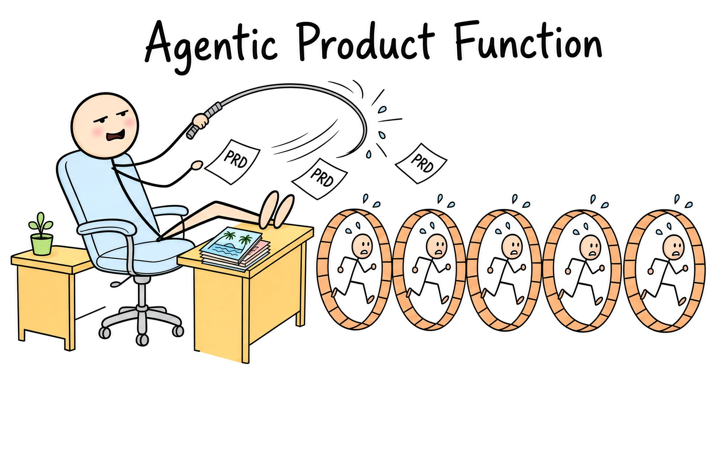
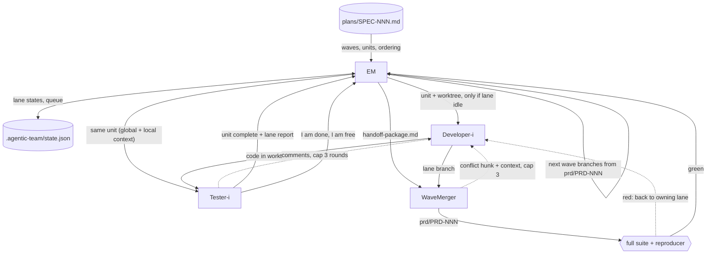
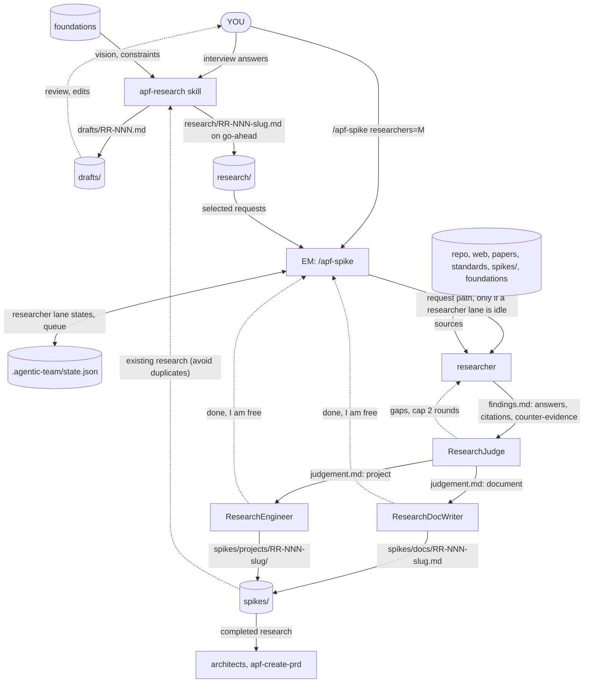

<p align="center"></p>

# agentic-product-function

NOTE. Requires a MAX plan, otherwise it's an exercise in hitting session/weekly limits.

A set of skills that models a product function as a team of agents, run as explicit commands. You write a PRD (`/apf-create-prd`). You ask the architect team to turn it into a spec you approve and then to plan it (`/apf-arch PRD-001`), through three gates: you approve the spec first, then an option after the code assessment, then the SOP; the architects then write the plan. You hand the plan to a development team of the size you choose (`/apf-dev PRD-001 lanes=3`): developer+tester lanes build it in git worktrees, verify it against the PRD, spec and SOP, and open a GitHub PR with `gh`. A second team of researchers closes research requests you write (`/apf-research`, then `/apf-spike researchers=2`) with a spike (a document or a small project) in `spikes/`. Nothing watches a directory and nothing runs on its own: every phase starts when you invoke its command, and each command is one session that does its phase and stops.

Organisation (grouping only, no flows; the flows are below):

```text
╔═ knowledge repo [artifacts] ═════════════════════════════════════════════╗
║ ┌─────────────────────┐ ┌─────────────────────┐ ┌─────────────────────┐  ║
║ │  product-vision.md  │ │guiding-principles.md│ │  company-context.md │  ║
║ └─────────────────────┘ └─────────────────────┘ └─────────────────────┘  ║
║ ┌─────────────────────┐ ┌─────────────────────┐ ┌─────────────────────┐  ║
║ │    conventions.md   │ │        prds/        │ │      research/      │  ║
║ └─────────────────────┘ └─────────────────────┘ └─────────────────────┘  ║
║ ┌─────────────────────┐ ┌─────────────────────┐ ┌─────────────────────┐  ║
║ │        specs/       │ │        sops/        │ │        plans/       │  ║
║ └─────────────────────┘ └─────────────────────┘ └─────────────────────┘  ║
║ ┌─────────────────────┐                                                  ║
║ │       spikes/       │                                                  ║
║ └─────────────────────┘                                                  ║
╚══════════════════════════════════════════════════════════════════════════╝
╔═ architecture ═══════════════════════════════════════════════════════════╗
║                     ┌──────────────────────────────┐                     ║
║                     │       architect-chief        │                     ║
║                     │          [AExpert]           │                     ║
║                     └──────────────────────────────┘                     ║
║ ┌─────────────────────┐ ┌─────────────────────┐ ┌─────────────────────┐  ║
║ │    architect-core   │ │   architect-cloud   │ │  architect-solution │  ║
║ │       [ACore]       │ │       [ACloud]      │ │     [ASolution]     │  ║
║ └─────────────────────┘ └─────────────────────┘ └─────────────────────┘  ║
║ ┌─────────────────────┐ ┌─────────────────────┐                          ║
║ │       prd-gap       │ │     support-sop     │                          ║
║ │       [PRDGap]      │ │        [SOP]        │                          ║
║ └─────────────────────┘ └─────────────────────┘                          ║
╚══════════════════════════════════════════════════════════════════════════╝
╔═ engineering (lane = developer + tester) ════════════════════════════════╗
║                     ┌──────────────────────────────┐                     ║
║                     │     engineering-manager      │                     ║
║                     │             [EM]             │                     ║
║                     └──────────────────────────────┘                     ║
║ ┌─────────────────────┐ ┌─────────────────────┐ ┌─────────────────────┐  ║
║ │     Developer-1     │ │     Developer-2     │ │     Developer-N     │  ║
║ │       Tester-1      │ │       Tester-2      │ │       Tester-N      │  ║
║ └─────────────────────┘ └─────────────────────┘ └─────────────────────┘  ║
║ ┌─────────────────────┐ ┌─────────────────────┐                          ║
║ │      WaveMerger     │ │       Verifier      │                          ║
║ └─────────────────────┘ └─────────────────────┘                          ║
╚══════════════════════════════════════════════════════════════════════════╝
╔═ research ═══════════════════════════════════════════════════════════════╗
║ ┌─────────────────────┐ ┌─────────────────────┐ ┌─────────────────────┐  ║
║ │     Researcher-1    │ │     Researcher-M    │ │    ResearchJudge    │  ║
║ └─────────────────────┘ └─────────────────────┘ └─────────────────────┘  ║
║ ┌─────────────────────┐ ┌─────────────────────┐                          ║
║ │  ResearchDocWriter  │ │   ResearchEngineer  │                          ║
║ └─────────────────────┘ └─────────────────────┘                          ║
╚══════════════════════════════════════════════════════════════════════════╝
                                                                   ╔═══════╗
                                                                   ║  YOU  ║
                                                                   ╚═══════╝
```

**Status:** tested by the author and working. See [Known gaps](#known-gaps) for what has not been exercised.

## Contents

1. [Install](#install)
2. [Tutorial](#tutorial)
3. [Players](#players)
4. [Artifacts: who writes and reads what](#artifacts-who-writes-and-reads-what)
5. [Flows](#flows)
6. [Data-flow DAGs](#data-flow-dags)
7. [Rules and caps](#rules-and-caps)
8. [Document standards](#document-standards)
9. [Skills and packaging](#skills-and-packaging)
10. [Known gaps](#known-gaps)

---

## Install

Six skills ship in this repo: `apf-product-foundations` (one-time setup of your vision, principles and company context), `apf-create-prd` (how you write PRDs), `apf-arch` (the architect team: spec, option, SOP and plan), `apf-dev` (the development team), `apf-research` (how you write research requests) and `apf-spike` (the researcher team). Install them with the [skills CLI](https://github.com/vercel-labs/skills) (skills.sh). The repo is public, so no authentication is needed.

**Prerequisites:** Node.js (for `npx`), a git repository with a GitHub remote, `gh` authenticated, and `python3` (for the status dashboard).

### 1. Preview what the repo offers (optional)
```bash
npx skills add gbarnett-hz/agentic-product-function --list
```
You should see six skills: `apf-product-foundations`, `apf-create-prd`, `apf-arch`, `apf-dev`, `apf-research` and `apf-spike`.

### 2. Install into your project
```bash
cd your-project
npx skills add https://github.com/gbarnett-hz/agentic-product-function
```
The CLI is interactive: pick the skills and agents. Installs to `./.claude/skills/` for Claude Code. Install all six: `apf-dev` and `apf-spike` read their roles, flows and templates from their sibling `apf-arch`.

### 3. Start a new Claude Code session
Skills load at session start. Then follow the [tutorial](#tutorial): `/apf-product-foundations` once, then `/apf-create-prd`, `/apf-arch PRD-001`, `/apf-dev PRD-001 lanes=3`, and `/apf-research` + `/apf-spike researchers=2` for research.

### Update
```bash
npx skills update
```

### Notes
- `apf-deep-code`, `apf-group-design`, `apf-deep-research` and `apf-plan` are bundled inside `apf-arch/vendor/` and read by path. They are not installed as separate skills, so they do not collide with skills of the same name you already have.
- Skills run with full agent permissions. Review them before use.
- Verified: `--list` and a non-interactive install of all `apf-` skills from `gbarnett-hz/agentic-product-function` on GitHub put them in `./.claude/skills/` as copies, with their supporting folders (also verified from a local checkout).

---

## Tutorial

Worked example: you want rate limiting on a service's public API.

### 0. Prerequisites
- A git repository containing the codebase the feature changes (ACore reads it). Run Claude Code from its root.
- `gh` installed and authenticated (`gh auth status`). GitHub is always the host.
- The skills installed (see [Install](#install)).
- `python3` (for the status dashboard).
- Your project's foundations written (step 1). `/apf-arch` and `/apf-dev` stop if they are missing.

### 1. Set up the foundations (once per project)
```
/apf-product-foundations
```
Before any PRD, the team needs to know what you are building and the rules you hold. The skill interviews you, one document at a time, and drafts each in `drafts/` for your approval:
- `product-vision.md`: the end goal, who it is for, what it will never be, how success is measured.
- `product-guiding-principles.md`: hard constraints (for example "Java 21", "zero runtime memory allocation") and judgement principles. Each one gets a rationale, its implications, a **verification** (a lint rule, benchmark or test, or `judgement`) and who may grant exceptions. Hard constraints get IDs (`HC-n`), principles `P-n`.
- `company-context.md`: the company's execution space and guiding philosophies (customers, strategy, constraints such as compliance, release cadence, approved technologies).

It offers suggestions from your repo (for example Java 21 from a build file) but never writes them as decided without your confirmation. Re-running refines existing files; it never silently overwrites them.

As each file is written it updates a managed block in `AGENTS.md` that references it, and makes sure `CLAUDE.md` imports `@AGENTS.md` (Claude Code reads `CLAUDE.md`, not `AGENTS.md`; it asks before editing an existing `CLAUDE.md`). Commit the files.

From here on the team uses them: architects rule out or flag options that violate a hard constraint, developers and testers adhere to them, and the Verifier checks them.

### 2. Write the PRD
```
/apf-create-prd
```
The skill orients itself (next ID, the three foundation files, research files if present), then interviews you in small batches: problem, goals and non-goals, users, requirements, success metrics, constraints and risks. It pushes back on vague requirements ("fast", "scalable") and asks for a measurable criterion. It keeps requirements to *what*, not *how*. Requirement IDs are `PR-1`, `PR-2`, ...

It writes `drafts/PRD-001.md` and edits it with you. After every change to the draft, **PRDGap** reads your foundations, earlier PRDs, specs, research, the code and git, and the web, and lists what the team would otherwise have to ask you later: vague requirements, missing targets, conflicts, hidden dependencies, operational needs. Each gap comes with a proposed answer and its evidence. You accept, edit or waive each one; accepted answers go into the PRD and waivers are recorded in section 8. Every such edit triggers another round, until a round reports `No open gaps.` The aim is that, after you sign off the spec and the SOP, nobody needs to ask you anything.

When you say it is ready (and the last round is clean), it writes `prds/PRD-001-api-rate-limiting.md` in one write and records that version's hash in `.agentic-team/state.json`. **Nothing picks the PRD up on its own**: when you are ready, run the architecture command.

### 3. Spec: ask the architect team
```
/apf-arch PRD-001
```
This session becomes the **EM** (engineering manager) of the architecture phase for this one PRD: it checks that the PRD is gap-clean (if you edited it after publishing, the gap analysis runs first), spawns an **AExpert** agent for the PRD, and relays its gates to you. AExpert lives from this spawn until it hands the finished plan back, then it and its architects are shut down and the session ends. It cannot talk to you directly: at each gate it writes the gate to a file, and the EM shows it to you and passes your answer back. Nothing watches any folder: without `/apf-arch PRD-001`, nothing would happen to the PRD.

AExpert's first move is a draft specification, **before any code analysis**: it turns every PRD requirement into given-when-then scenarios in `drafts/SPEC-001.md`. Every scenario has an ID (`R-1`...) linked to your `PR-n`, and is design-independent — no implementation, technology or file paths. The EM shows you the draft. Approve it, or ask for changes in plain language; AExpert edits the draft in place and the EM shows it to you again. When you approve, it moves to `specs/SPEC-001.md`. The spec's design sections stay empty for now; they are filled in after you pick an option (step 5), with no second approval.

### 4. Architecture runs
Only now does the full analysis start. Behind the scenes:
1. ACore reads your codebase (`apf-deep-code`), writes or refreshes `conventions.md` (your formatters, linters, patterns, and each technology's idiom), then proposes competing designs (`apf-group-design`).
2. ACloud and ASolution run in parallel on ACore's output (`apf-deep-research`: your knowledge repo first, then the web): cloud side effects, and fit in enterprise deployments.
3. AExpert launches adversarial agents, chosen for this PRD (for example: "what breaks during a rolling upgrade?", "is every claim cited?"). It can send components back to the architects, at most 2 rounds.

You can step away. It takes a while.

### 5. Gate: pick an option
If `conventions.md` is new or changed, the gate includes it so you can correct it. Then a short table: one row per option, scored on **risk, complexity, future evolution, fit for purpose**, with links to the detail, plus its recommendation. You can:
- Pick an option: "Option B".
- Ask for a scoped re-run: "redo ACloud, assuming multi-region".

When you pick, AExpert completes the spec's design sections from the chosen option (design, cloud and enterprise impact, risks, test strategy, operational hooks, decision record) — no second approval.

### 6. Gate: approve the SOP
SOP builds `drafts/SOP-001.md` from the completed spec: one runbook scenario per risk ("if you see X, do Y, roll back with Z"). If a risk has no usable monitoring signal, the SOP records a gap and AExpert fixes the spec first (you re-approve that part).

If you want something in the SOP addressed, say so. AExpert re-runs the architecture flow, scoped to exactly what you asked, and a spec change needs your re-approval of the delta.

When the SOP is approved, it moves to `sops/SOP-001.md`.

### 7. The plan (no review needed)
AExpert runs `apf-plan` on the approved spec and SOP: test-first steps grouped into waves, parallel by default. It writes `plans/SPEC-001.md`, hands it to the EM, and the `/apf-arch` session ends. You do not review the plan.

### 8. Engineering: hand the plan to the development team
```
/apf-dev PRD-001 lanes=3
```
You choose the team size: 3 lanes means 3 developers, each paired with a tester; lanes are `L1`..`L3` for the session, and units queue if all lanes are busy. The EM dispatches the plan's units to **idle lanes only**, wave by wave. For each unit:
- A worktree is created; the developer works in it following `conventions.md`, runs the format, lint and type checks until clean, and sends the result to its paired tester, who re-runs the checks and reviews idiom.
- They loop on comments (max 3 rounds). The tester declares the unit complete and reports "I am done, I am free". The EM sends that lane the next queued unit.
- Tests are isolated per worktree: each worktree gets its own key, port block and temp dir from the EM, and tests use them for every port, file, database and container, so one worktree's tests cannot affect another's (see [Test isolation](#test-isolation)). A unit that needs a resource that cannot be namespaced is marked `Exclusive:` and runs alone.
- Every unit gets a **new** developer and tester; when it completes they are finished and the lane takes its next unit with fresh agents, so one unit's context never leaks into the next. They work from file paths, write their report to `.agentic-team/reports/`, and reply in a few lines.
- A wave must be merged before the next wave starts. If a plan is split across lanes, the **WaveMerger** merges the lane worktrees into `prd/PRD-001` and runs the full suite and the reproducer. A plan taken by one lane needs no merge.

Progress is announced as it happens (see [Follow progress](#follow-progress)); raw state is in `.agentic-team/state.json`.

### 9. Verification and the PR
The **Verifier** checks the output against every requirement ID and SOP scenario, citing code and test results.
- **CONFORMS:** the EM pushes `prd/PRD-001` and runs `gh pr create` with a full description (summary, requirement table, SOP link, test results, risks). The URL is in `state.json` and the session ends. **Review and merge the PR yourself.**
- **Gaps:** the Requirement Gap flow runs (next section). At most 2 gap cycles, then it escalates to you.

### 10. Next PRD
Just run `/apf-create-prd` again, then `/apf-arch PRD-002` for the new PRD once its gaps are closed. Commands are explicit and sequential: run one at a time (the shared `state.json` has a single writer), and nothing starts until you invoke it.

### 11. Run a spike (research)
```
/apf-research
```
The skill interviews you and writes a research request in the fixed template: objective, specific research questions (`Q-1`...), context, scope, sources to consult, depth (`quick` / `standard` / `deep`), exit criteria, deliverable (`document`, `project` or `ResearchJudge decides`) and constraints. When you approve, it writes `research/RR-001-<slug>.md`. Nothing picks it up on its own.

```
/apf-spike RR-001 researchers=2
```
(or `/apf-spike researchers=2` to run every pending request). The command gives you 2 researcher lanes; an idle lane takes a whole request. Its **researcher** investigates with several angle agents in parallel (repo, web, papers, standards, prior art, and always adversarial ones that try to disprove the leading conclusions), then hands the findings to the lane's **ResearchJudge**. The ResearchJudge checks them against your exit criteria (sending gaps back, at most 2 rounds), decides the artifact type, and routes to exactly one producer:
- a **ResearchDocWriter** writes `spikes/docs/RR-001-<slug>.md`, or
- a **ResearchEngineer** builds and runs `spikes/projects/RR-001-<slug>/`.

The EM tells you the artifact path when the lane is free again. There is no human gate: read the spike and decide. Architects and `/apf-create-prd` read `spikes/` as context for later work. Spikes are left uncommitted in your working tree.

### Follow progress
A PRD or a research request can take a long time. The command you are running announces **every state transition** in two places:

1. **A chat line** in your session: `[PRD-001] <what happened> · <phase> · <progress> · waiting on <who>`.
```
[PRD-001] PRD gap round 2: 3 open gaps · prd-gap · waiting on you
[PRD-001] plan received: 23 steps in 4 waves · planned
[PRD-001] step 7/23 done (wave 2/4) · engineering · Developer-2 on 8-9, round 2/3
[PRD-002] queued: all 3 lanes busy · planned · waiting on capacity
[RR-001] assigned to R1 · researching
```
2. **A dashboard**, `.agentic-team/status.md`, rewritten at every transition. In another terminal: `watch cat .agentic-team/status.md`. It shows, at the top, **what needs you** (gates, gap answers, blocked lanes, escalations); then every PRD with its phase pipeline, plan progress (`steps done/total`, wave n of W), lanes on it and PR link; all engineering lanes; researcher lanes and requests; and the last 20 events.

"Step N of P" counts plan steps whose unit the tester has signed off (P is the number of Todo items in `plans/SPEC-NNN.md`). The dashboard is rendered by `scripts/render-status.py` from `.agentic-team/state.json`.

### Test isolation
Lanes, the WaveMerger and the Verifier run tests at the same time, across worktrees, so test strategy has to fit worktree isolation:
- **ACore** records how your project does (or does not) isolate ports, temp files and databases/containers in `conventions.md` under "Test isolation", with violations listed as gaps.
- **The EM of `/apf-dev`** gives every worktree an isolation key (`APF_KEY`), a 100-port block (`APF_PORT_BASE`) and `TMPDIR=<worktree>/.apf-tmp`, and tells the agent to export them for every test command.
- **Developers** write tests that use them (port 0 or the block, `$TMPDIR`, names containing `APF_KEY`, teardown after) and fix violating tests they touch. **Testers** review against the rules; the **WaveMerger** and **Verifier** run in their own keyed worktrees.
- A resource that cannot be namespaced (shared staging, a licensed or single-instance service) is listed as **exclusive**; plan units that need it are marked `Exclusive: <resource>` and the EM never runs two at once.
- When a worktree is removed the EM runs the project's teardown for its key and frees its port block.

### Troubleshooting
| Symptom | Cause / fix |
|---|---|
| `/apf-arch` or `/apf-dev` stops and asks for foundations | The three files are missing from the project root. Run `/apf-product-foundations`. |
| Wrote a PRD, nothing happened | Nothing watches `prds/`. Run `/apf-arch PRD-NNN`. |
| Edited a PRD after publishing it | Expected: `/apf-arch` compares the file hash to the recorded gap-clean hash and re-runs the PRD gap analysis before architecture; if a spec or plan already exists, tell it to run scoped to the change. |
| Wrote a research request, nothing happened | Nothing watches `research/`. Run `/apf-spike researchers=M`. |
| Research requests queue | All researcher lanes are busy; they start when a lane reports free. Check `state.json`. |
| Units not starting | All lanes busy; units queue until a lane reports free. Check `state.json`. |
| PR step fails | `gh auth status`; confirm the repo has a GitHub remote. |

---

## Players

| Agent | Role |
|---|---|
| **YOU** | Human in the loop. Write PRDs (with `apf-create-prd`), invoke the commands, make every approval decision at gates 1-3. |
| **EM** (engineering-manager) | The main session of whichever command is running: `/apf-arch` runs the architecture phase for one PRD, `/apf-dev` the engineering phase, `/apf-spike` the research phase. Never plans, designs or writes code. Checks the PRD's gap-clean record before architecture, relays AExpert's gates to you, dispatches plans to lanes by capacity, pushes PRs with `gh`. Announces every state transition (chat line plus `.agentic-team/status.md`). One command at a time. |
| **AExpert** (architect-chief) | Manager of the architecture team and the final word on architecture. A **spawned agent per PRD**: the `/apf-arch` session spawns it when the PRD is gap-clean and it is shut down when it hands the plan to the EM, ending the command. Drafts the spec before any code analysis, spawns the architects and the adversarial agents, completes the spec after the option, runs `apf-plan`. Does not talk to you directly: gates 1-3 go through the EM. |
| **PRDGap** (prd-gap) | Finds what the PRD leaves unsaid (ambiguity, untestable requirements, conflicts, hidden dependencies, operational needs) from foundations, earlier PRDs, specs, research, code, git and web. Proposes a cited answer per gap. Runs after every PRD modification, so the flow after the spec and SOP gates needs no questions. |
| **ACore** (architect-core) | `apf-deep-code` to understand the codebase against the approved spec, then `apf-group-design` to formulate candidate designs. |
| **ACloud** (architect-cloud) | ACore's output + `apf-deep-research`: side effects on cloud deployment. |
| **ASolution** (architect-solution) | ACore's output + `apf-deep-research`: the PRD in enterprise deployments with existing services. |
| **SOP** (support-sop) | Builds the SOP from the approved spec. |
| **Lane** (Developer-i + Tester-i) | A developer paired with a tester. N lanes, chosen when `/apf-dev` is invoked. Each unit of work is isolated in a git worktree. |
| **WaveMerger** | Merges lane worktrees into one output worktree when a plan is split across lanes. |
| **Verifier** | Checks finished work against the PRD, spec requirement IDs and SOP. Produces a gap report. |
| **Researcher lane** (Researcher + ResearchJudge + ResearchDocWriter + ResearchEngineer) | M lanes, chosen when `/apf-spike` is invoked (`researchers=M`). Each lane has its own Researcher, ResearchJudge, ResearchDocWriter and ResearchEngineer (1:1, like Developer:Tester), so there is no shared producer pool. A lane takes one research request in its entirety. |
| **Researcher** | Researches the request thoroughly, adversarially and objectively with parallel angle agents (`apf-deep-research`; `apf-deep-code` for code angles): knowledge repo first, then web, papers, standards, prior art. Writes findings. |
| **ResearchJudge** | Checks the findings against the exit criteria (gaps go back to the researcher, cap 2), decides the artifact type (`document` or `project`) and routes to one producer. |
| **ResearchDocWriter** | Writes the spike document to `spikes/docs/`. |
| **ResearchEngineer** | Builds and runs the spike project in `spikes/projects/`. |

---

## Artifacts: who writes and reads what

| Artifact | Path (in your project) | Written by | Read by | Template |
|---|---|---|---|---|
| PRD draft | `drafts/PRD-NNN.md` | `apf-create-prd` | YOU | `apf-create-prd/templates/prd.md` |
| PRD | `prds/PRD-NNN-<slug>.md` | `apf-create-prd` (on your go-ahead) | `/apf-arch` (EM), AExpert, ACore, ACloud, ASolution, Verifier | `apf-create-prd/templates/prd.md` |
| Product vision | `product-vision.md` (project root) | `apf-product-foundations` | apf-create-prd, AExpert, architects, Verifier | `apf-product-foundations/templates/product-vision.md` |
| Guiding principles | `product-guiding-principles.md` (HC-n hard constraints, P-n principles) | `apf-product-foundations` | apf-create-prd, AExpert, architects, SOP, developers, testers, Verifier | `apf-product-foundations/templates/product-guiding-principles.md` |
| Company context | `company-context.md` | `apf-product-foundations` | apf-create-prd, AExpert, ACloud, ASolution, SOP | `apf-product-foundations/templates/company-context.md` |
| Agent references | `AGENTS.md` managed block (+ `CLAUDE.md` importing `@AGENTS.md`) | `apf-product-foundations` | every agent in the project | none |
| Other knowledge-repo context | `market-analysis` + codebase, github, web, papers | YOU / existing | apf-create-prd, AExpert, architects | none |
| PRD gap report | `drafts/PRD-NNN.gaps.md` | PRDGap | YOU, `apf-create-prd`, `/apf-arch` | `templates/prd-gap-report.md` |
| Conventions (incl. test isolation) | `conventions.md` (project root; shown to you at gate 2 when new or changed) | ACore | AExpert, `apf-plan`, developers, testers, WaveMerger, Verifier | `templates/conventions.md` |
| Candidate options | `.agentic-team/arch/PRD-NNN/acore.md` | ACore | ACloud, ASolution, AExpert | none |
| Cloud impact / enterprise fit | `.agentic-team/arch/PRD-NNN/acloud.md`, `asolution.md` | ACloud / ASolution | AExpert | none |
| Option table (gate 2) | `.agentic-team/arch/PRD-NNN/gate-2.md`, relayed by the EM | AExpert | YOU | `templates/option-table.md` |
| Spec draft | `drafts/SPEC-NNN.md` | AExpert | YOU | `templates/spec.md` |
| Spec (approved) | `specs/SPEC-NNN.md` | AExpert (on approval); sections 5-12 completed after gate 2, no re-approval | ACore, ACloud, ASolution, SOP, `apf-plan`, lanes, WaveMerger, Verifier | `templates/spec.md` |
| SOP draft | `drafts/SOP-NNN.md` | SOP | YOU, AExpert | `templates/sop.md` |
| SOP (approved) | `sops/SOP-NNN.md` | AExpert (on approval) | `apf-plan`, lanes, WaveMerger, Verifier | `templates/sop.md` |
| Plan | `plans/SPEC-NNN.md` (+ `.candidate-*.md`) | AExpert via `apf-plan` | `/apf-dev` (EM), lanes, WaveMerger | `vendor/apf-plan` |
| Research request draft | `drafts/RR-NNN.md` | `apf-research` | YOU | `apf-research/templates/research-request.md` |
| Research request | `research/RR-NNN-<slug>.md` | `apf-research` (on your go-ahead) | `/apf-spike` (EM), researcher, ResearchJudge | `apf-research/templates/research-request.md` |
| Findings and judgement | `.agentic-team/research/RR-NNN/findings.md`, `judgement.md` | researcher, ResearchJudge | ResearchJudge, ResearchDocWriter, ResearchEngineer | none |
| Spike document | `spikes/docs/RR-NNN-<slug>.md` | ResearchDocWriter | YOU, architects, `apf-create-prd`, `apf-research` | `templates/spike-document.md` |
| Spike project | `spikes/projects/RR-NNN-<slug>/` (README + code) | ResearchEngineer | YOU, architects, `apf-create-prd`, `apf-research` | `templates/spike-project-readme.md` |
| Status dashboard | `.agentic-team/status.md` | the running command (via `scripts/render-status.py`) | YOU | none |
| Orchestration state | `.agentic-team/state.json` | the running command only (single writer; `apf-create-prd` records the PRD's gap-clean hash) | the running command | `roles/engineering-manager.md` |
| Unit worktree + lane report | `../<repo>.worktrees/…` | developer / tester | WaveMerger, Verifier | none |
| Handoff package | in the WaveMerger's prompt | EM | WaveMerger | `templates/handoff-package.md` |
| Integration branch | `prd/PRD-NNN` | WaveMerger | Verifier, EM | git |
| Gap report | `.agentic-team/reports/PRD-NNN/gap-cycle-<n>.md` | Verifier | EM, AExpert | `templates/gap-report.md` |
| Lane report | `.agentic-team/reports/PRD-NNN/unit-<steps>.md` | developer | tester, WaveMerger | none |
| Architect outputs | `.agentic-team/arch/PRD-NNN/acore.md`, `acloud.md`, `asolution.md` | ACore, ACloud, ASolution | AExpert, later scoped re-runs | none |
| Pull request | GitHub | the `/apf-dev` EM (`gh pr create`) | YOU | `templates/pr-description.md` |

`specs/` and `sops/` hold approved artifacts only. Drafts live in `drafts/`.

---

## Flows

### PRD gap analysis (owner: `apf-create-prd`; `/apf-arch` when a published PRD was edited)

| Step | Actor | Input | Output |
|---|---|---|---|
| 1 | `apf-create-prd` (new draft) or `/apf-arch` (a published PRD that was edited) | a new or modified PRD | spawns PRDGap |
| 2 | PRDGap | PRD, foundations, knowledge repo, code, git, web | `drafts/PRD-NNN.gaps.md`: open gaps only, max 10, each with a proposed answer and evidence |
| 3 | **YOU** | each gap | accepted, edited or waived |
| 4 | caller | decisions | PRD updated (answers into sections, waivers into section 8); back to step 1 |

Done is a round with `No open gaps.` `apf-create-prd` publishes only then and records the clean version's hash in `state.json`, and that clean round is the precondition for AExpert. `/apf-arch` compares the hash before it spawns AExpert: if the published PRD was edited, it re-runs the flow first, and if a spec or plan already exists, AExpert runs scoped to the change.

### Architecture (owner: AExpert, a spawned agent per PRD)

Precondition: the PRD gap analysis is clean for the current version (`apf-create-prd` publishes only a gap-clean PRD and records its hash; `/apf-arch` re-checks it and re-runs the gap analysis if the file changed).

| Step | Actor | Input | Output |
|---|---|---|---|
| 1 | EM (`/apf-arch PRD-NNN`) | gap-clean `prds/PRD-NNN.md` | spawns AExpert for this PRD |
| 2 | AExpert | PRD, foundations, knowledge repo | `drafts/SPEC-NNN.md`: given-when-then scenarios per PRD requirement (no code analysis) |
| 3 | **Gate 1** (you) | draft spec | approval, or changes (loop to 2) → `specs/` |
| 4 | ACore | approved spec, repo | understanding + candidate options |
| 5 | ACloud, ASolution (parallel) | ACore output | cloud impact, enterprise fit |
| 6 | AExpert + adversarial agents | all outputs | findings; redo requests (cap 2 rounds) |
| 7 | **Gate 2** (you) | option table | chosen option |
| 8 | AExpert | chosen option | spec sections 5-12 completed in `specs/` (no re-approval) |
| 9 | SOP | completed spec | `drafts/SOP-NNN.md` (+ gaps) |
| 10 | **Gate 3** (you) | draft SOP | approval → `sops/`, or a scoped re-run of the architecture flow (fresh 2-round cap) |
| 11 | AExpert | spec AND SOP approved | `plans/SPEC-NNN.md` → EM; AExpert is shut down, the EM creates `prd/PRD-NNN` and the command ends |

The spec is approved before any code analysis: its scenarios are design-independent. Sections 5-12 are completed after the option choice with no further approval; a change to an approved scenario (sections 1-4) needs re-approval of the delta. A spec change caused by SOP feedback needs re-approval of the delta only. The gate to the EM is spec approved AND SOP approved. **Lifetime:** the architecture function for a PRD runs from the `/apf-arch` spawn until AExpert replies `PLAN`. AExpert writes each gate to a file and ends its turn; the EM shows it to you and resumes AExpert with your answer. Later work (a Requirement Gap in `/apf-dev`, or a re-run after a PRD change) gets a **new** AExpert given the files.

### Engineering (owner: the EM of `/apf-dev`, capacity `lanes=N`)

1. The command selects the PRD and its plan, then dispatches the plan's units to **idle** lanes only, wave by wave. No idle lane means units queue, even when a plan is ready.
2. Each unit gets a worktree. The lane's developer and tester get paths to the spec, SOP and plan plus a unit brief (the plan steps, the requirement IDs `R-n`, SOP scenarios `S-n` and spec sections they cite). They read only what is relevant to their unit: its steps in full, the plan outline, the cited spec rows and sections, the cited SOP scenarios, the guiding principles and conventions; anything else on demand.
3. developer → tester → comments → developer, **cap 3 rounds**, then escalate to the EM, then you. The tester declares the unit complete and tells the EM which plan steps are done and "I am done, I am now free"; the EM reports `step N/P`.
4. A crashed or stalled lane: the EM reassigns its unit to another idle lane.
5. Plan split across lanes: after each wave the **WaveMerger** merges into `prd/PRD-NNN` (next wave branches from it). Plan taken by a single lane: no merge.
6. The **Verifier** checks the output. `CONFORMS` → the EM pushes and opens the PR, and the command ends. Gaps → Requirement Gap.

**WaveMerger handoff package:** spec, SOP, whole plan, ordering constraints, base commit SHA, each unit's file ownership and requirement IDs, each lane's diff and report (what changed, why, interfaces touched, tests added). After a merge it runs the full suite and the plan's reproducer. An unresolvable conflict goes back to the owning lane with the hunk, both sides and the context (cap 3), then to the EM, then to you.

**Pull request:** always GitHub, always `gh`, always described: summary, PRD and spec IDs, requirement table (where implemented and tested), SOP link and Verifier result, test results, risks and gap cycles, and the Claude Code attribution line.

### Requirement Gap (lighter variant of the architecture flow)

Runs inside `/apf-dev` when the Verifier reports gaps.
1. The Verifier writes a gap report: each unmet or partial requirement ID or SOP item, with evidence.
2. The EM spawns a **new** AExpert for the gap and counts the cycle.
3. AExpert runs a scoped flow: ACore (`apf-deep-code` on the gap only); ACloud/ASolution only if the gap touches their area; adversarial review narrowed to the gap; gate 2 skipped (the chosen option stands). A needed spec or SOP change goes to you for re-approval (gates 1/3); otherwise no human gate.
4. AExpert runs a scoped `apf-plan` for only the units that close the gap.
5. The EM dispatches to idle lanes, merges, and the Verifier checks again.
6. Cap: 2 gap cycles, then escalate to you.

### Research (owner: the EM of `/apf-spike`, capacity `researchers=M`)

A researcher lane is four role agents: researcher, ResearchJudge, ResearchDocWriter and ResearchEngineer. `researchers=M` gives M lanes. Each lane owns its own ResearchJudge, ResearchDocWriter and ResearchEngineer, 1:1 with its Researcher (like Developer:Tester in an engineering lane), so `researchers=M` gives M of each and the producers are never a shared bottleneck. One request occupies one lane from start to finish; it is never split across lanes.

1. The `/apf-spike` command selects its requests: the `RR-NNN` argument, or every pending request in `research/`. There is no watcher; a request sits until the command runs.
2. The EM assigns each to an **idle** researcher lane only; no idle lane means it queues. Researcher capacity is separate from the engineering lanes.
3. **researcher:** runs parallel angle agents (repo, history, tests, web, papers, standards, prior art, empirical evidence) plus adversarial angles (counter-evidence, source quality and bias, and at `deep` an independent re-derivation). Reconciles into `findings.md` with an answer, confidence and citations per question, counter-evidence, limitations and an exit-criteria check.
4. **ResearchJudge:** checks the findings against the exit criteria (gaps back to the researcher, **cap 2 rounds**), then decides `document` or `project` (a project when closing the request needs executable evidence such as a benchmark, proof of concept or reproduction), writes `judgement.md` and routes to exactly one producer.
5. **ResearchDocWriter** writes `spikes/docs/RR-NNN-<slug>.md`, or **ResearchEngineer** builds and runs `spikes/projects/RR-NNN-<slug>/` and records observed results in its README.
6. The producer tells the EM "RR-NNN done, I am now free"; the EM frees the lane, tells you the artifact path and dispatches the next queued request. When every selected request is done, the command stops.

No human gate: ambiguity is recorded as an assumption and listed in the spike. Spikes recommend; you decide.

---

## Data-flow DAGs

Each edge is labelled with the artifact it carries. Solid edges form the DAG for one PRD; dashed edges are feedback loops (each capped, see [Rules and caps](#rules-and-caps)).

### End to end

```mermaid
flowchart TD
    subgraph KR["Knowledge repo"]
        CTX[("research, market-analysis,<br/>codebase, github, web, papers")]
        FND[("product-vision.md<br/>product-guiding-principles.md<br/>company-context.md<br/>AGENTS.md block")]
        PRDS[("prds/")]
        DRAFTS[("drafts/")]
        SPECS[("specs/")]
        SOPS[("sops/")]
        PLANS[("plans/")]
        SPK[("spikes/")]
    end

    YOU -->|"interview answers (once)"| PF[apf-product-foundations]
    PF -->|"foundation files + AGENTS.md block"| FND
    YOU([YOU]) -->|"interview answers"| CP[apf-create-prd]
    FND -->|"vision, constraints, context"| CP
    CTX -->|"research, related PRDs"| CP
    CP -->|"drafts/PRD-NNN.md"| DRAFTS
    DRAFTS -.->|"review, edits"| YOU
    CP -->|"prds/PRD-NNN-slug.md on go-ahead + clean hash"| PRDS
    CP -->|"draft, after every change"| PG[PRDGap]
    PG -->|"gaps + proposed answers"| CP
    CP -->|"accept / edit / waive"| PG
    YOU -->|"/apf-arch PRD-NNN"| EMA["EM: /apf-arch"]
    EMA -->|"hash mismatch: edited published PRD"| PG
    PG -->|"No open gaps"| EMA
    CTX -->|"code, git, web, research"| PG
    EMA -->|"spawn AExpert: gap-clean PRD"| AE[AExpert]
    AE -->|"SPEC draft (given-when-then,<br/>no code analysis)"| DRAFTS
    DRAFTS -->|"drafts/SPEC-NNN.md, relayed by EM"| G1{{"Gate 1: YOU approve spec"}}
    G1 -->|"approved spec"| SPECS
    SPECS -->|"specs/SPEC-NNN.md"| AE
    AE -->|"spec + PRD"| AC[ACore]
    CTX -->|"code, history"| AC
    AC -->|"understanding (apf-deep-code)"| ACL[ACloud]
    AC -->|"understanding (apf-deep-code)"| AS[ASolution]
    CTX -->|"web, papers (apf-deep-research)"| ACL
    CTX -->|"web, papers (apf-deep-research)"| AS
    AC -->|"understanding + candidate options (apf-group-design)"| AE
    ACL -->|"cloud impact per option"| AE
    AS -->|"enterprise fit per option"| AE
    AE -->|"candidate outputs"| ADV[Adversarial agents]
    ADV -->|"findings, ungrounded claims"| AE
    AE -->|"gate-2.md, relayed by EM"| G2{{"Gate 2: YOU pick option"}}
    G2 -->|"chosen option, relayed by EM"| AE
    AE -->|"complete spec sections 5-12 (no re-approval)"| SPECS
    SPECS -->|"completed spec"| SOP
    SOP -->|"SOP draft"| DRAFTS
    DRAFTS -->|"drafts/SOP-NNN.md, relayed by EM"| G3{{"Gate 3: YOU approve SOP"}}
    G3 -->|"approved SOP"| SOPS
    SPECS -->|"spec (scenarios, design)"| AE
    SOPS -->|"SOP (operational hooks)"| AE
    AE -->|"apf-plan: plans/SPEC-NNN.md, waves + deps; AExpert then shut down"| PLANS
    YOU -->|"/apf-dev PRD-NNN lanes=N"| EMD["EM: /apf-dev"]
    PLANS -->|"plan"| EMD
    EMD -->|"unit + spec + SOP + plan"| LANES["Lanes: Developer-i + Tester-i,<br/>one worktree per unit"]
    LANES -->|"lane report + branch"| INT[WaveMerger]
    LANES -.->|"I am done, I am free"| EMD
    INT -->|"prd/PRD-NNN merged worktree"| VER[Verifier]
    SPECS -->|"scenario IDs"| VER
    SOPS -->|"scenarios + hooks"| VER
    PRDS -->|"PR-n requirements"| VER
    VER -->|"CONFORMS"| EMD
    EMD -->|"gh pr create: pr-description.md"| PR([GitHub PR])
    PR -->|"review, merge"| YOU
    EMD -.->|"status line + status.md on every transition"| YOU
    SPK -->|"completed research"| AE
    SPK -->|"completed research"| CP
    FND -->|"vision, HC-n, P-n, context"| AE
    FND -->|"HC-n, P-n"| LANES
    FND -->|"HC-n checks"| VER

    VER -.->|"gap-report.md"| EMD
    EMD -.->|"gap-report.md"| AE
    AE -.->|"scoped plans/ delta"| EMD
    AE -.->|"redo component, cap 2"| AC
    AE -.->|"redo component, cap 2"| ACL
    AE -.->|"redo component, cap 2"| AS
    G1 -.->|"change requests, relayed by EM"| AE
    G2 -.->|"scoped re-run request, relayed by EM"| AE
    G3 -.->|"scoped re-run request, relayed by EM"| AE
    SOP -.->|"spec operational-hook gaps"| AE
```



### Engineering detail (one wave)



### Research



---

## Rules and caps

| Rule | Value |
|---|---|
| Commands | user-triggered only: `/apf-create-prd`, `/apf-arch PRD-NNN`, `/apf-dev [PRD-NNN] lanes=N`, `/apf-research`, `/apf-spike [RR-NNN] researchers=M`. No watchers; nothing runs on its own. One command at a time (`state.json` has a single writer) |
| Who talks to you about architecture | AExpert, through the `/apf-arch` EM: it writes each gate to a file and the EM relays it and your answer |
| Architecture lifetime | AExpert and its architects are spawned per PRD by `/apf-arch` when the PRD is gap-clean and shut down when the plan is handed to the EM, which ends the command; later work gets new agents |
| Status updates | on every state transition: one chat line, `state.json` updated, `.agentic-team/status.md` re-rendered; the dashboard's "Needs you" lists everything waiting on you |
| PRD gap analysis | `apf-create-prd` after every draft change, and `/apf-arch` before architecture when the PRD's hash no longer matches the recorded clean version, until `No open gaps.`; max 10 gaps per round; a clean published PRD goes straight to AExpert |
| Free-running | after gate 3 no questions to you unless a cap escalates; unanswered ambiguity becomes a recorded assumption in the PR description |
| Grounding | Every claim cites a `file:line` or URL; AExpert enforces |
| Architecture redo loop | 2 rounds, then escalate to you |
| Scoped re-run after you change the SOP | fresh 2-round cap |
| Dev ↔ test loop | 3 rounds, then EM, then you |
| WaveMerger conflict loop | 3 rounds, then EM, then you |
| Requirement Gap cycles | 2, then escalate to you |
| Adversarial angles | chosen per PRD |
| Gate to the EM | spec approved AND SOP approved |
| Plan review | none, it goes straight to the EM of `/apf-dev` |
| Capacity | `/apf-dev lanes=N`; lanes only, no idle lane means no dispatch |
| Researcher capacity | `/apf-spike researchers=M` lanes, separate from engineering lanes; one request per lane, never split; no idle lane means it queues |
| ResearchJudge ↔ researcher loop | 2 rounds, then proceed with the gaps marked in the spike |
| Research human gate | none; assumptions and gaps are recorded in the spike |
| Context hygiene | one agent per task, never reused (a lane is a capacity slot, not an agent); unique agent names per task; paths not pasted contents; developers and testers read only their unit's slice of the spec, SOP and plan; agents write detail to files and reply in at most 15 lines; the EM reads summaries, not reports |
| Parallelism | by default, if the plan permits |
| Test isolation | tests in one worktree never affect another: per-worktree key, port block and temp dir; resources named by key; teardown after; exclusive resources run one at a time |
| Idiom and conventions | `conventions.md` authority order: project's enforced config, then surrounding code, then the technology's community idiom (cited) |
| Convention checks | developer runs format/lint/types before handoff; tester re-runs and reviews idiom; WaveMerger re-runs after each merge; Verifier reports violations as gaps |
| Done means | the work addresses the PRD, the spec, the SOP and the conventions |
| Output | one branch and one GitHub PR per PRD; one spike per research request (`spikes/docs/` or `spikes/projects/`) |

---

## Document standards

Decided once and used always.

| Document | Standard | Template |
|---|---|---|
| PRD | No single standard; the sections common across Atlassian, Product School and others (problem, goals/non-goals, users, requirements with acceptance criteria, metrics, constraints, open questions). PRD requirements get IDs (`PR-n`). | `templates/prd.md` |
| Spec | Given-when-then behavioural requirements from the PRD (ID'd, `R-n`), approved before any code analysis, kept separate from the design ("how", RFC/design-doc style) which is completed after the option choice, with a MADR 4.0 decision record. | `templates/spec.md` |
| Research request | Agile spike (question, exit criteria, deliverable) combined with a research brief (objective, context, scope, method, follow-ups). The spike's time-box becomes a depth level (quick / standard / deep) because agents do not work in days. Questions get IDs (`Q-n`). | `apf-research/templates/research-request.md` |
| Spike (output) | Research report, answer first: summary and recommendation, answers per question with confidence, method, findings, counter-evidence, exit criteria, limitations, follow-ups, references. A project's README follows the same shape. | `templates/spike-document.md`, `templates/spike-project-readme.md` |
| PRD gap report | Table of open gaps, each with the PRD location, why a downstream agent would have to ask, a proposed answer, its evidence and a kind (`evidence`, `assumption`, `needs-human`). Gap IDs `G-n`. | `templates/prd-gap-report.md` |
| SOP | Incident-runbook structure: severity, detection, immediate response, investigation, mitigation, rollback, communication, escalation, post-incident. | `templates/sop.md` |

Caveats: The given-when-then form follows BDD practice (from the Cucumber documentation). The SOP structure comes from third-party runbook templates, not the Google SRE book or PagerDuty docs directly (those did not come up in search).

---

## Skills and packaging

- **Vendored (bundled in `apf-arch/vendor/`, adapted where noted):** `apf-deep-code`, `apf-group-design`, `apf-deep-research` (knowledge repo first, then the web, parallel angle agents including adversarial ones, a cited answer-first report; used by ACloud, ASolution and the Researcher), `apf-plan` (AExpert builds the skeleton from the approved spec and SOP, not the chat; writes to `plans/`; the "parallel agents?" question is skipped; follows `conventions.md`).
- **Ours:** `apf-product-foundations`, `apf-create-prd`, `apf-research`, and the three team commands `apf-arch` (architecture phase), `apf-dev` (engineering phase) and `apf-spike` (research phase). `apf-dev`, `apf-spike` and `apf-create-prd` read the shared roles, flows and templates from their sibling `apf-arch`, so install them together.

Repo layout. The CLI finds a skill at each `skills/<name>/SKILL.md`. A `SKILL.md` shadows anything nested below it, which is why the vendored skills sit under `vendor/` (bundled, not listed separately) and the command skills are siblings.

```
README.md  logo.jpg                       repo docs (not part of any skill)
skills/
  apf-arch/                 installed as one skill; the architect team and the shared machinery
    SKILL.md                               entry point: /apf-arch PRD-NNN
    roles/                                 engineering-manager (the phase EM), architect-chief,
                                           architect-core, architect-cloud, architect-solution,
                                           prd-gap, support-sop, developer, tester, wave-merger,
                                           verifier, researcher, research-judge, research-doc-writer,
                                           research-engineer
    flows/                                 prd-gap.md, architecture.md, engineering.md,
                                           requirement-gap.md, research.md
    templates/                             spec, sop, conventions, option-table, gap-report,
                                           handoff-package, pr-description, spike-document,
                                           spike-project-readme, prd-gap-report
    vendor/                                apf-deep-code, apf-group-design, apf-deep-research,
                                           apf-plan (read by path)
    scripts/render-status.py               state.json -> .agentic-team/status.md dashboard
  apf-dev/                  installed as its own skill; reads ../apf-arch
    SKILL.md                               entry point: /apf-dev [PRD-NNN] lanes=N
  apf-spike/                installed as its own skill; reads ../apf-arch
    SKILL.md                               entry point: /apf-spike [RR-NNN] researchers=M
  apf-create-prd/                          installed as its own skill; runs PRDGap from apf-arch
    SKILL.md
    templates/prd.md
  apf-research/                            installed as its own skill
    SKILL.md
    templates/research-request.md
  apf-product-foundations/                 installed as its own skill; run once first
    SKILL.md
    templates/                             product-vision, product-guiding-principles, company-context
```

The knowledge-repo directories (`prds/ specs/ sops/ plans/ drafts/`) and `.agentic-team/` live in your project and are created on first run.

---

## Known gaps

- There is no watcher anywhere: a published PRD or research request does nothing until you run `/apf-arch` or `/apf-spike`. An edit to a published PRD is caught by the hash check the next time `/apf-arch` runs; between the edit and that run nothing re-analyses it, and an edit made while `/apf-dev` is building the plan is not noticed at all.
- One command at a time: `.agentic-team/state.json` has a single writer, so two commands running concurrently (even for different PRDs) can lose each other's state.
- `/apf-dev` and `/apf-spike` read roles, flows and templates from the sibling `apf-arch` install; installing them without `apf-arch` does not work.
- Convention checks are only as strong as the project's tooling. Where no formatter or linter exists, `conventions.md` records it under Gaps and testers cover it by hand.
- Install is verified from GitHub and from a local path with the current names (skills found and installed with all supporting folders). `-g`, symlink mode, `update` and `remove` are untested.
- Whether the skills.sh website needs anything beyond a public GitHub repo to list the skills is unknown.
- Naming: you wrote both `spike` and `spikes`; this uses `spikes/` (with `docs/` and `projects/`). Spikes are left uncommitted in the working tree (no PR per spike), and the research flow has no human gate. Say if you want either changed.
- Each command session is fresh, but a long `/apf-dev` run (several waves, gap cycles) still lives in one session and relies on Claude Code's automatic compaction; `.agentic-team/state.json` is its memory across the compaction.
- AExpert as a spawned agent assumes it can spawn its own architects and be resumed after each gate with SendMessage. If it cannot spawn, it asks the EM to spawn on its behalf (`SPAWN` lines); this fallback and the resume are untested.
- Developers and testers read only their unit's slice, which depends on the plan's `Cites:` lines being complete. A step that omits a requirement or SOP scenario it depends on makes the agent read it on demand, or miss it; the Verifier still checks the whole output against every requirement and scenario.
- Test isolation is enforced by review (tester and Verifier read the tests and run them with the keyed environment), not by a sandbox. A test that ignores the key can still collide. Real shared environments (staging, cloud accounts) are only protected if they are listed as exclusive.
- Greenfield projects: ACore reads the codebase and derives `conventions.md` and designs from it, so an empty repo gives weak output. Seed some code first.
