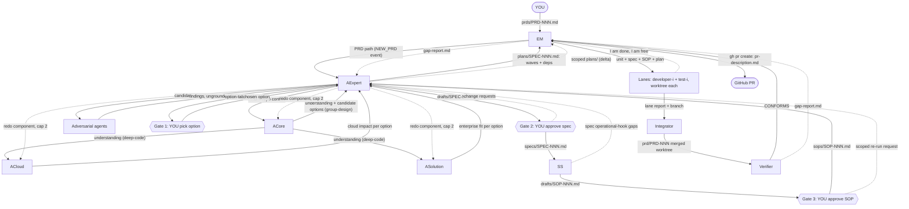

# agentic-product-function

A skill that models a product function as a team of agents. See `agentic-team.png` for the diagram (needs updating: lanes are dev+test pairs, plus the integrator and verifier roles below).

**Status:** design in progress. Architecture and engineering functions agreed; nothing is built yet.

## Players

| Agent | Role |
|---|---|
| **YOU** | Human in the loop. Writes PRDs, makes every approval decision. |
| **EM** (engineering-manager) | The main session. Watches `prds/` (fswatch / inotifywait via Monitor, trigger on close_write/moved_to, processed-PRD marker), starts the flow, hands control to AExpert for architecture, dispatches the plan to lanes by capacity, tracks free lanes. |
| **AExpert** (architect-chief) | Manages the architecture team and has the final word. Runs adversarial review, writes the spec, runs action-plan. The only agent that talks to you. Also a role played by the main session (shape A). |
| **ACore** (architect-core) | `deep-code` to understand the codebase against the PRD, then `group-design` to formulate candidate designs. |
| **ACloud** (architect-cloud) | ACore output + `deep-research`: side effects on cloud deployment. |
| **ASolution** (architect-solution) | ACore output + `deep-research`: PRD in enterprise deployments with existing services. |
| **SS** (support-sop) | Builds the SOP from the approved spec: if X goes wrong do Y; if you observe Z do W. |
| **Lane** (developer-i + test-i) | A dev paired with a tester. N lanes, set when the skill is invoked. Works one unit of work in its own git worktree. |
| **Integrator** | Merges lane worktrees into one output worktree when a plan is split across lanes. Not needed for a single-lane plan. |
| **Verifier** | Checks finished work against the PRD, spec requirement IDs and SOP. Produces a gap report. |

Knowledge repo (artifacts): specs, plans, sops, drafts, prds, product-vision*, company-vision*, research, git, market-analysis, github, web, research papers. (*optional)

## Flow: architecture

```
PRD ─► EM ─► AExpert ─► ACore: deep-code, then group-design ─► candidate options
                              ├─► ACloud    (ACore output + deep-research)   ┐ parallel
                              └─► ASolution (ACore output + deep-research)   ┘
                        ▼
   AExpert: per-PRD adversarial agents, grounding checks, redo of any of the
   three (cap 2 rounds, then escalate to you)
                        ▼
   GATE 1  you pick an option from the table:
           risk | complexity | future evolution | fit for purpose (succinct, with refs)
                        ▼
   AExpert writes the draft spec to drafts/  (RFC/design-doc + MADR template)
                        ▼
   GATE 2  you review the spec; changes loop back to AExpert
                        ▼
   Approved spec ─► specs/ ─► SS builds the SOP from the spec
                        ▼
   GATE 3  you review the SOP
           └─ changes requested: AExpert re-runs the architecture flow, scoped
              to what you asked for (fresh 2-round cap). If the spec changes,
              it needs re-approval (the delta only).
                        ▼
   Spec approved AND SOP approved ─► SOP written to sops/
                        ▼
   AExpert runs action-plan (parallel by default, no question asked) ─► plans/ ─► EM
   (no human review of the plan)
```

## Flow: engineering

```
plan (steps, waves, ordering constraints) ─► EM
   │  EM dispatches units to FREE lanes only; if all lanes are busy, units queue.
   │  A wave's steps run in parallel across free lanes; next wave waits for
   │  the previous one to be merged.
   ▼
Lane i:  developer-i ──work (own git worktree)──► test-i
              ▲                                     │
              └──── comments, loop (cap 3) ─────────┘
         test-i declares the unit complete ─► tells EM "I am done, I am free"
   │
   ▼
Plan split across lanes?
   yes ─► Integrator merges lane worktrees at each wave boundary into the PRD
          integration worktree (next wave branches from it). Conflicts are
          resolved by the integrator using the handoff package below.
   no  ─► the lane's worktree is the output
   ▼
Verifier checks output vs PRD + spec requirement IDs + SOP
   ├─ all met ─► EM pushes the branch and opens a PR with `gh` (one branch + one PR per PRD)
   └─ gaps ─► Requirement Gap process (below)
```

### Pull request

GitHub is always the host, and the EM always uses `gh`. Every PR is described properly:
- Summary of the change, and the PRD and spec (ID) it implements.
- Requirement table: each requirement ID and where it is implemented and tested.
- Link to the SOP, and the Verifier's conformance result.
- Test results (full suite and the plan's reproducer).
- Notes on risks and any Requirement Gap cycles that happened.
- Ends with the Claude Code attribution line.

- **Lane loop cap:** 3 rounds, then escalate to EM, then you.
- **Lane failure or stall:** the EM reassigns the unit to another lane.
- **Dev and test context:** each lane reads the spec, the SOP, the whole plan (global context) and its own unit (local context).

### Integrator handoff package

The integrator gets everything it needs to resolve conflicts without guessing:
spec, SOP, whole plan, ordering constraints, base commit SHA, each unit's step definition and file ownership from the plan, each lane's diff and report (what changed, why, interfaces touched, tests added). After a merge it runs the full suite and the plan's reproducer. When it can't resolve a conflict it sends the hunk, both sides and the context back to the owning lane (cap 3), then escalates to EM, then you.

### Requirement Gap process (lighter variant of the architecture flow)

1. The Verifier produces a gap report: each unmet or partially met requirement ID or SOP item, with evidence.
2. The EM hands the report to AExpert.
3. AExpert runs a scoped flow:
   - ACore runs `deep-code` on the gap only. ACloud/ASolution only run if the gap touches their area.
   - Adversarial review, narrowed to the gap.
   - Gate 1 is skipped; the chosen option stands.
   - If the gap needs a spec or SOP change, that is a delta and needs your re-approval (gates 2/3). Otherwise no human gate.
4. AExpert runs a scoped action-plan: only the units needed to close the gap.
5. The EM dispatches to free lanes, then the Verifier checks again.
6. Cap: 2 gap cycles, then escalate to you.

## Data-flow DAG

Each edge is labelled with the artifact it carries. Solid edges form the DAG for one PRD. Dashed edges are feedback loops (redo, change requests, gaps), each capped as described under Rules.



## Rules

- **Only AExpert talks to you.**
- **Grounding:** every claim must be grounded in fact (cited). AExpert enforces this.
- **Redo cap:** 2 rounds per request, then AExpert escalates to you.
- **Adversarial angles** are chosen per PRD.
- **Gate to the EM** is approval of the spec AND the SOP.
- **`specs/` and `sops/` hold approved artifacts only.** Drafts live in `drafts/`.
- **Capacity:** lanes are the only capacity. No free lane means no dispatch, even if a new plan is ready.
- **Done means** the work addresses the PRD, the spec and the SOP.

## Document standards (decided, always used)

| Document | Standard | Template |
|---|---|---|
| PRD | No single standard; the sections common across Atlassian, Product School and others (problem, goals/non-goals, users, requirements with acceptance criteria, metrics, constraints, open questions). PRD requirements get IDs (PR-n). | `templates/prd.md` |
| Spec | IEEE 29148-style verifiable, ID'd requirements ("what") kept separate from the design ("how", RFC/design-doc style), with a MADR 4.0 decision record. | `templates/spec.md` |
| SOP | Incident runbook structure: severity, detection, immediate response, investigation, mitigation, rollback, communication, escalation, post-incident. | `templates/sop.md` |

Caveats: IEEE 29148 is paywalled, so its structure comes from secondary sources. The SOP structure comes from third-party runbook templates, not the Google SRE book or PagerDuty docs directly (those didn't come up in search).

## Spec template (fixed, always used)

RFC/design-doc style plus a MADR decision record.

- **Metadata:** ID, title, status, author, link to the PRD
- **Sections:**
  - Summary
  - Motivation
  - Goals and non-goals
  - Requirements: IDs (R-1, R-2, ...), RFC 2119 MUST/SHOULD wording
  - Design
  - Alternatives considered (from the option table)
  - Cloud impact
  - Enterprise impact
  - Compatibility and upgrade
  - Risks and mitigations
  - Test strategy and acceptance criteria, traceable to requirement IDs
  - Operational hooks (where the SOP attaches)
  - Open questions
  - References
- **Decision record (MADR):** chosen option, rejected options and why

## Skills

- **Vendored (copied into this repo, adapted where noted):**
  - `deep-code`
  - `group-design`
  - `action-plan`: AExpert builds the skeleton from the approved spec and SOP (not the chat), writes to `plans/`, and the "parallel agents?" question is skipped (parallel by default).
- **Ours:** `create-prd` (`skills/create-prd`): interviews you, drafts to `drafts/PRD-NNN.md`, and on your go-ahead writes the PRD to `prds/` using `templates/prd.md`. That write starts the flow, so start the EM first.
- **Referenced, not copied:** `deep-research` from Anthropic's `anthropic-skills`. Installers need that plugin as well.

## Packaging

One distributable skill (skills.sh).

```
SKILL.md              entry point
roles/                one file per agent (engineering-manager, architect-chief, architect-core,
                      architect-cloud, architect-solution, support-sop, developer, tester,
                      integrator, verifier)
flows/                architecture.md, engineering.md, requirement-gap.md
templates/            prd, spec, sop, option-table, gap-report, handoff-package, pr-description
skills/               vendored: deep-code, group-design, action-plan (adapted)
scripts/watch-prds.py kqueue watcher (poll fallback elsewhere)
```

The knowledge-repo directories (`prds/ specs/ sops/ plans/ drafts/`) and `.agentic-team/state.json` live in the user's project and are created on first run.

## Invocation

`/agentic-product-function lanes=5` starts the EM with 5 lanes (5 developers, each paired with a tester). Capacity is fixed for the life of the session. The EM then watches `prds/` and runs the flows above.

## Open

Built, untested. Not yet verified end to end:
- Whether subagents can message each other (developer ↔ tester) as `engineering.md` assumes.
- The watcher's Linux path is a 2s poll, not inotify.
- `deep-research` must be installed separately.
