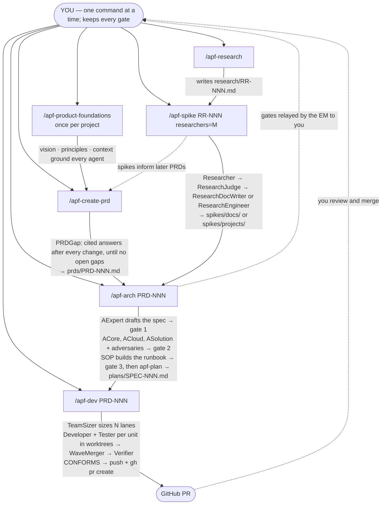

<p align="center"></p>

# agentic-product-function

NOTE. Requires a MAX plan, otherwise it's an exercise in hitting session/weekly limits.

Models a product function as a team of agents, run as explicit commands. You write a PRD, the architect team turns it into a spec, an option and a SOP that you approve at three gates and then plans it, the development team builds the plan in git worktrees and opens a GitHub PR, and a research team closes research requests as spikes. Nothing watches a directory and nothing runs on its own: every phase starts when you invoke its command, and each command is one session that does its phase and stops.

**Status:** tested by the author and working. See [Known gaps](#known-gaps).

## Contents

1. [Install](#install)
2. [Command flow](#command-flow)
3. [Agents](#agents)
4. [Artifacts](#artifacts)
5. [Rules and caps](#rules-and-caps)
6. [Skills and packaging](#skills-and-packaging)
7. [Known gaps](#known-gaps)

---

## Install

Six skills ship in this repo: `apf-product-foundations` (one-time setup), `apf-create-prd` (writing PRDs), `apf-arch` (spec, option, SOP and plan), `apf-dev` (development team), `apf-research` (writing research requests) and `apf-spike` (researcher team). Install them with the [skills CLI](https://github.com/vercel-labs/skills) (skills.sh). The repo is public, so no authentication is needed.

**Prerequisites:** Node.js (for `npx`), a git repository with a GitHub remote, `gh` authenticated, and `python3` (for the status dashboard).

```bash
cd your-project
npx skills add https://github.com/gbarnett-hz/agentic-product-function
```

The CLI is interactive: pick the skills and agents. Install all six (`apf-dev` and `apf-spike` read their roles, flows and templates from their sibling `apf-arch`), then start a new Claude Code session: skills load at session start.

```bash
npx skills update   # update later
```

Notes:
- `apf-deep-code`, `apf-group-design`, `apf-deep-research` and `apf-plan` are bundled inside `apf-arch/vendor/` and read by path; they are not installed as separate skills, so they do not collide with skills of the same name you already have.
- Skills run with full agent permissions. Review them before use.

---

## Command flow



| Command | Phase | What it does |
|---|---|---|
| `/apf-product-foundations` | setup, once | Interviews you into the vision, guiding principles and company context every agent is grounded in. |
| `/apf-create-prd` | product | Interviews you into a PRD; PRDGap closes gaps after every change; publishes on your go-ahead. |
| `/apf-arch PRD-NNN` | architecture | Spec (gate 1) → assessment and option pick (gate 2) → SOP (gate 3) → plan. |
| `/apf-dev [PRD-NNN]` | engineering | TeamSizer sizes the team; lanes build, test and merge wave by wave; Verifier signs off; branch pushed and PR opened. |
| `/apf-research` | research | Interviews you into a research request (objective, questions `Q-n`, depth, exit criteria, deliverable). |
| `/apf-spike [RR-NNN] researchers=M` | research | M researcher lanes close requests, one whole request per lane, as a document or a small project. |

Progress: every state transition prints one chat line (`[PRD-001] <what happened> · <phase> · <progress> · waiting on <who>`) and rewrites `.agentic-team/status.md`; watch it in another terminal with `watch cat .agentic-team/status.md`. "Needs you" is listed at the top.

---

## Agents

| Agent | Group | Synopsis |
|---|---|---|
| **YOU** | all | Human in the loop. Write PRDs and research requests (with the interview skills), invoke every command, make every gate decision (spec, option, SOP), review and merge the PR. |
| **EM** (engineering-manager) | all | The main session of whichever command is running (`/apf-arch`, `/apf-dev` or `/apf-spike`). Never plans, designs or writes code. Checks the PRD's gap-clean record, relays AExpert's gates to you, dispatches plan units to idle lanes, keeps `state.json` and the dashboard current, pushes the branch and opens the PR with `gh`. One command at a time. |
| **AExpert** (architect-chief) | architecture | Manager of the architecture team, spawned per PRD and shut down when it hands over the plan. Drafts the spec before any code analysis, spawns the architects and adversarial agents, completes the spec after your option pick, runs `apf-plan`. Cannot talk to you directly: gates go through the EM. |
| **PRDGap** (prd-gap) | product | After every PRD change, finds what the PRD leaves unsaid (vague requirements, missing targets, conflicts, hidden dependencies, operational needs) from foundations, earlier PRDs, specs, research, code, git and the web. Proposes a cited answer per gap (max 10/round) for you to accept, edit or waive. |
| **ACore** (architect-core) | architecture | Deep-codes the codebase against the approved spec, writes or refreshes `conventions.md` (including test isolation), then proposes competing designs (`apf-group-design`). |
| **ACloud** (architect-cloud) | architecture | Researches cloud-deployment side effects for each candidate option (`apf-deep-research`). |
| **ASolution** (architect-solution) | architecture | Researches how the PRD fits enterprise deployments with existing services, per option. |
| **SOP** (support-sop) | architecture | Builds the incident-runbook SOP from the approved spec: one runbook scenario per risk ("if you see X, do Y, roll back with Z"); flags risks with no usable monitoring signal for AExpert to fix. |
| **TeamSizer** (team-sizer) | engineering | Runs on every `/apf-dev`: reads the plan's waves, step sizes and `Exclusive:` resources and picks the lane count (no more than the effective widest wave, fewer when steps serialize). Prints its number and reasoning and writes `team-size.md`. |
| **Developer-i** | engineering | One per lane, a **new agent per unit**. Builds the unit in its own git worktree following `conventions.md`, runs format, lint and type checks until clean, then hands to its paired tester. |
| **Tester-i** | engineering | One per lane, a **new agent per unit**, paired 1:1 with Developer-i. Re-runs the checks, reviews idiom and test isolation, loops comments with the developer (max 3 rounds), declares the unit complete and reports "I am done, I am now free". |
| **WaveMerger** | engineering | Merges the lane worktrees into `prd/PRD-NNN` after each wave when a plan is split across lanes, runs the full suite and the reproducer, and resolves conflicts with the owning lane (max 3 rounds). |
| **Verifier** | engineering | Checks the finished output against every PRD requirement ID and SOP scenario, citing code and test results. `CONFORMS` → the EM opens the PR; gaps → the Requirement Gap flow (max 2 cycles). |
| **Researcher** | research | Investigates the request with parallel angle agents (repo, history, tests, web, papers, standards, prior art) plus adversarial ones, and reconciles everything into `findings.md` with an answer, confidence and citations per question. |
| **ResearchJudge** | research | Checks the findings against the request's exit criteria (gaps go back, max 2 rounds), decides `document` or `project`, writes `judgement.md` and routes to exactly one producer. |
| **ResearchDocWriter** | research | Writes the spike document to `spikes/docs/`. |
| **ResearchEngineer** | research | Builds and runs the spike project in `spikes/projects/` and records observed results. |

A **lane** is a capacity slot, not an agent: an engineering lane is Developer-i + Tester-i, a researcher lane is Researcher + ResearchJudge + ResearchDocWriter + ResearchEngineer (1:1, so `researchers=M` gives M of each; the producers are never a shared bottleneck).

---

## Artifacts

| Artifact | Path (in your project) | Written by |
|---|---|---|
| Foundations | `product-vision.md`, `product-guiding-principles.md`, `company-context.md` (root) | `/apf-product-foundations` |
| PRD draft → published | `drafts/PRD-NNN.md` → `prds/PRD-NNN-<slug>.md` | `/apf-create-prd` (gap-clean hash recorded) |
| PRD gap report | `drafts/PRD-NNN.gaps.md` | PRDGap |
| Spec draft → approved | `drafts/SPEC-NNN.md` → `specs/SPEC-NNN.md` | AExpert |
| Architect outputs | `.agentic-team/arch/PRD-NNN/acore.md`, `acloud.md`, `asolution.md`, `gate-2.md` | ACore, ACloud, ASolution, AExpert |
| Conventions | `conventions.md` | ACore |
| SOP draft → approved | `drafts/SOP-NNN.md` → `sops/SOP-NNN.md` | SOP (AExpert on approval) |
| Plan | `plans/SPEC-NNN.md` | AExpert via `apf-plan` |
| Research request draft → published | `drafts/RR-NNN.md` → `research/RR-NNN-<slug>.md` | `/apf-research` |
| Spike | `spikes/docs/RR-NNN-<slug>.md` or `spikes/projects/RR-NNN-<slug>/` | the researcher lane |
| Reports | `.agentic-team/reports/PRD-NNN/` (team-size, unit reports, gap cycles) | TeamSizer, developers, Verifier |
| Dashboard and state | `.agentic-team/status.md`, `.agentic-team/state.json` | the running command only (single writer) |
| Integration branch and PR | `prd/PRD-NNN`, GitHub | WaveMerger, the `/apf-dev` EM |

`specs/` and `sops/` hold approved artifacts only; drafts live in `drafts/`. All documents use fixed templates in `apf-arch/templates/` (plus `apf-create-prd/templates/prd.md` and `apf-research/templates/research-request.md`).

---

## Rules and caps

| Rule | Value |
|---|---|
| Commands | user-triggered only; no watchers, nothing runs on its own; one command at a time (`state.json` has a single writer) |
| Gates | 1 spec, 2 option, 3 SOP — always yours (relayed by the EM); the plan is never reviewed |
| PRD gap analysis | after every draft change until a round reports `No open gaps.` (max 10 gaps/round); `/apf-arch` re-runs it if a published PRD was edited |
| Architecture redo loop | 2 rounds, then escalate to you |
| Dev ↔ test loop | 3 rounds, then EM, then you |
| WaveMerger conflict loop | 3 rounds, then EM, then you |
| Requirement Gap cycles | 2, then escalate to you |
| ResearchJudge ↔ researcher loop | 2 rounds, then proceed with the gaps marked in the spike |
| Capacity | TeamSizer picks N from the plan on every `/apf-dev` and prints it; no idle lane means units queue. Researcher capacity is `researchers=M`, separate from engineering; one request per lane, never split |
| Test isolation | tests in one worktree never affect another: per-worktree key, port block and temp dir; resources named by the key; `Exclusive:` resources run one at a time |
| Context hygiene | one agent per task, never reused; paths passed, not pasted contents; agents write detail to files and reply in at most 15 lines; the EM reads summaries |
| Grounding | every claim cites a `file:line` or URL; AExpert enforces |
| Output | one branch and one GitHub PR per PRD; one spike per research request |

---

## Skills and packaging

- **Ours:** `apf-product-foundations`, `apf-create-prd`, `apf-research`, and the three team commands `apf-arch` (architecture), `apf-dev` (engineering) and `apf-spike` (research). `apf-dev`, `apf-spike` and `apf-create-prd` read the shared roles, flows and templates from their sibling `apf-arch`, so install them together.
- **Vendored (bundled in `apf-arch/vendor/`, read by path):** `apf-deep-code`, `apf-group-design`, `apf-deep-research`, `apf-plan`.

```
README.md  logo.jpg                       repo docs (not part of any skill)
skills/
  apf-arch/                 one skill; the architect team and the shared machinery
    SKILL.md                               entry point: /apf-arch PRD-NNN
    roles/                                 engineering-manager, architect-chief, architect-core,
                                           architect-cloud, architect-solution, prd-gap,
                                           support-sop, team-sizer, developer, tester,
                                           wave-merger, verifier, researcher, research-judge,
                                           research-doc-writer, research-engineer
    flows/                                 prd-gap, architecture, engineering,
                                           requirement-gap, research
    templates/                             spec, sop, conventions, option-table, gap-report,
                                           prd-gap-report, handoff-package, pr-description,
                                           spike-document, spike-project-readme
    vendor/                                apf-deep-code, apf-group-design,
                                           apf-deep-research, apf-plan
    scripts/render-status.py               state.json -> .agentic-team/status.md
  apf-dev/                  entry point: /apf-dev [PRD-NNN]; reads ../apf-arch
  apf-spike/                entry point: /apf-spike [RR-NNN] researchers=M; reads ../apf-arch
  apf-create-prd/           entry point: /apf-create-prd; runs PRDGap from apf-arch
  apf-research/             entry point: /apf-research
  apf-product-foundations/  entry point: /apf-product-foundations; run once first
```

The knowledge-repo directories (`prds/ specs/ sops/ plans/ drafts/ research/ spikes/`) and `.agentic-team/` live in your project and are created on first run.

---

## Known gaps

- No watcher anywhere: a published PRD or research request does nothing until you run `/apf-arch` or `/apf-spike`. An edit to a published PRD is only caught by the hash check the next time `/apf-arch` runs, and an edit made while `/apf-dev` is building the plan is not noticed at all.
- One command at a time: `.agentic-team/state.json` has a single writer, so two concurrent commands (even for different PRDs) can lose each other's state.
- `/apf-dev` and `/apf-spike` read roles, flows and templates from the sibling `apf-arch` install; installing them without `apf-arch` does not work.
- TeamSizer's optimum is a heuristic read of the plan's own wave analysis: optimistic wave grouping misleads it, and wall-clock vs token cost is a judgement call. There is deliberately no per-invocation override.
- Convention checks are only as strong as the project's tooling; where no formatter or linter exists, `conventions.md` records it under Gaps and testers cover it by hand.
- Install is verified from GitHub and a local path with the current names. `-g`, symlink mode, `update` and `remove` are untested; whether the skills.sh website needs anything beyond a public GitHub repo is unknown.
- Spikes are left uncommitted in the working tree (no PR per spike), and the research flow has no human gate: read the spike and decide.
- Each command session is fresh, but a long `/apf-dev` run still lives in one session and relies on Claude Code's automatic compaction; `state.json` is its memory across the compaction.
- AExpert spawning its own architects and being resumed after each gate (`SendMessage`) is assumed; the fallback (asking the EM to spawn via `SPAWN` lines) and the resume are untested.
- Developers and testers read only their unit's slice, which depends on the plan's `Cites:` lines being complete; the Verifier still checks the whole output against every requirement and scenario.
- Test isolation is enforced by review (tester and Verifier run tests with the keyed environment), not by a sandbox: a test that ignores the key can still collide, and shared environments are only protected if listed as exclusive.
- Greenfield projects: ACore derives `conventions.md` and designs from the codebase, so an empty repo gives weak output. Seed some code first.
